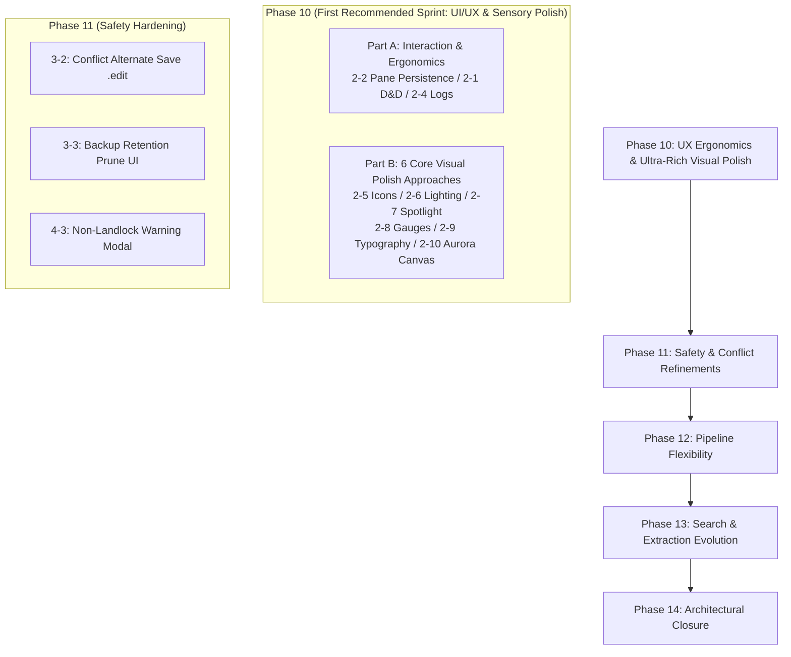

# Cuddle (FileWorkbench) Next Implementation Tasks & Roadmap

  <strong>English</strong> | <a href="NEXT_IMPLEMENTATION_TASKS.ja.md">日本語</a>

**Document Date:** 2026-10-27  
**Status:** Approved (Triaged and specified 18 items from Design Specification ver 0.9)  
**Audience:** Developers, Architects, Next Engineering Sessions  

---

## 1. Overview and Objectives

This document provides a systematic backlog and implementation guide for the **18 items identified during the cross-verification** between the Master Design Specification ([`FileWorkbench-Design-ver0.9.en.md`](FileWorkbench-Design-ver0.9.en.md)) and the current codebase (as of Phase 9.8 completion), plus **6 Core Visual Polish & Sensory Upgrade tasks** for a total of 24 items. It details the **prioritization, architectural design, affected files, and testing strategies** so that future engineering sessions can immediately start implementation without ambiguity.

### Non-Negotiable Core Principles
1. **Absolute Original Protection:** Direct in-place editing of original files is strictly prohibited. Operations must only run within working copies (`workspace-temp/`), reflecting to originals only upon explicit user confirmation.
2. **Kernel Isolation with Landlock LSM:** External commands and parsers must execute under restrictive Landlock rulesets (read-only system whitelist, dedicated isolated `TMPDIR`).
3. **Full Bilingual Synchronization (EN/JA):** All UI strings, logs, warnings, and documentation must exist in both English and Japanese with 100% parity.
4. **Dual-Key Non-UTF-8 Path Safety:** Non-UTF-8 paths with invalid byte sequences must be preserved safely via `FileItem` (`item_id` + `raw_base64` + safe `display_name`).
5. **Deterministic Safety and Rollback:** Any discrepancy or error triggers a safe fail-stop with deterministic rollback to the pre-operation state.

---

## 2. Task List and Priority Matrix

The 24 items are organized across **5 implementation phases (Phase 10 to 14)** based on dependency, risk, complexity, and user experience value.

| ID | Category | Task Name | Recommended Phase | Priority | Complexity | Status |
| :--- | :--- | :--- | :--- | :---: | :---: | :---: |
| **2-2** | UI / Layout | Pane Width & Layout Persistence across Sessions | **Phase 10** | **High** | Low | **Done & Verified** |
| **2-1** | UI / Workflow | Drag & Drop (D&D) between Browser & Workspace | **Phase 10** | **High** | Med | **Done & Verified** |
| **2-4** | UI / Logs | Pipeline Log Display Filter (`all` / `hidden` / `file_only`) | **Phase 10** | **High** | Low | **Done & Verified** |
| **2-5** | UI / Visual | Extension-Specific Rich Icons | **Phase 10** | **High** | Low | **Done & Verified** |
| **2-6** | UI / Visual | Lighting & Depth Layering (Inner Rim Light & Multi-layer Shadows) | **Phase 10** | **High** | Low | **Done & Verified** |
| **2-7** | UI / Visual | Cursor Spotlight Glow & Tactile Spring Feedback | **Phase 10** | **High** | Med | **Done & Verified** |
| **2-8** | UI / Visual | Storage Capacity Gauges & Visual Permissions/Size Metrics | **Phase 10** | **High** | Med | **Done & Verified** |
| **2-9** | UI / Visual | Tabular Precision Typography & Interactive Breadcrumb Trail | **Phase 10** | **High** | Low | **Done & Verified** |
| **2-10** | UI / Visual | Ambient Aurora Mesh Canvas & Subtle Micro-Grain Texture | **Phase 10** | **Medium** | Low | **Done & Verified** |
| **3-2** | Safety / Reflect | Alternate Filename UI on Original Conflict (e.g., `.edit.pdf`) | **Phase 11** | **High** | Med |
| **3-3** | Safety / Backup | Backup Retention (Default 5, Max 10) & Prune UI | **Phase 11** | **High** | Med |
| **4-3** | Safety / Sandbox | Warning / Consent Modal on Non-Landlock Kernels | **Phase 11** | **Medium** | Low |
| **4-2** | Pipeline | Custom `allowed_read_paths` in Pipeline Presets | **Phase 12** | **High** | Med |
| **4-1** | Pipeline | Input Modes (`batch`, `stdin`) & Typed Placeholders | **Phase 12** | **Medium** | Med |
| **2-3** | UI / System | Desktop Environment Native Notification Abstraction | **Phase 12** | **Medium** | Med |
| **1-4** | Search / Extract | Structured Markdown / HTML Text Extraction | **Phase 13** | **Medium** | Med |
| **1-3** | Search / Extract | Tier 3: Office Document Extraction (`.docx`, `.xlsx`) | **Phase 13** | **Medium** | High |
| **1-2** | Search / Engine | Combined Morphological (IPADIC) + n-gram Search | **Phase 13** | **Medium** | High |
| **1-1** | Search / Queue | Index Update / Repair Queue for Discrepancies | **Phase 13** | **Low** | High |
| **1-5** | Search / Policy | Per-Rule Indexing Policy (Metadata-only / Filename-only) | **Phase 13** | **Low** | Med |
| **3-1** | Safety Policy | 4-Tier Confirmation Levels (Brief / Standard / Detailed / Strict) | **Phase 14** | **Re-evaluate** | Med |
| **3-4** | Crash Recovery | 4-Table Crash Recovery State Machine Transition | **Phase 14** | **Keep Current** | High |
| **5-1** | Configuration | Splitting into 10 Granular TOML Sections | **Phase 14** | **Keep Current** | Med |
| **6-1** | IPC Optimization | Chunked Streaming / Pagination for Large Result Sets | **Phase 14** | **Benchmark First** | High |

---

## 3. Detailed Phase-by-Phase Implementation Plans

### Phase 10: Quick UX & Interaction Wins & Ultra-Rich Visual Polish [Completed & Verified by User]
Delivers immediate day-to-day workflow improvements (Part A) alongside a comprehensive sensory and visual upgrade to world-class design standards (Part B).

#### Part A: Interaction & Ergonomics

##### [Task 2-2] Pane Width & Layout Persistence across Sessions
* **Design Spec Reference:** Section 3.2 (Screen Structure & Layout)
* **Current Status:** `react-resizable-panels` initializes with static default ratios (52%, 20%, 68%, 50%), resetting whenever the app restarts.
* **Architecture & Strategy:**
  * Utilize `autoSaveId="cuddle-main-layout"` in `react-resizable-panels` or implement `onLayout={(sizes) => ...}` saving serialized pane ratios to `localStorage`.
  * Automatically restore pane proportions on window resize and startup.
* **Target Files:**
  * `src/App.tsx`
* **Verification:** Vitest test with mocked `localStorage`; manual pane resize and reload test.

##### [Task 2-1] Drag & Drop (D&D) between Browser & Workspace
* **Design Spec Reference:** Section 3.2 (Operation Flow)
* **Current Status:** Files can only be staged via toolbar buttons ("Stage Working Copy", "Stage All") and context menu.
* **Architecture & Strategy:**
  * Enable `draggable={true}` on `FileBrowserPanel.tsx` rows, writing `item_id` and `raw_base64` to `dataTransfer` on `dragstart`.
  * Implement `onDragOver` (`preventDefault()`) and `onDrop` in `WorkspacePanel.tsx`.
  * Trigger `handleStageFile(item)` upon drop to safely create working copies in `workspace-temp/`. Originals remain completely untouched.
* **Target Files:**
  * `src/components/FileBrowserPanel.tsx`
  * `src/components/WorkspacePanel.tsx`
  * `src/App.tsx`
* **Verification:** Vitest mock DragEvent tests (`fireEvent.dragStart`, `fireEvent.drop`).

##### [Task 2-4] Pipeline Log Display Filter Modes
* **Design Spec Reference:** Section 8.4 (Pipeline Logs and Audit Trails)
* **Current Status:** Flat linear string dump inside `BottomTabPanel.tsx`.
* **Architecture & Strategy:**
  * Refactor log model into structured entries or parse prefix tags: `LogEntry { id, timestamp, level, target_file, message }`.
  * Add toggle pills (`All`, `File Only` [file transformations only], `Hidden` [errors and major events only]) to the top bar of the log panel.
* **Target Files:**
  * `src/components/BottomTabPanel.tsx`
  * `src/locales/ja/translation.json`, `src/locales/en/translation.json`
* **Verification:** Vitest test verifying filtering behavior on log lines.

---

#### Part B: Ultra-Rich Visual Polish (6 Core Approaches)

##### [Task 2-5] Extension-Specific Rich Icons
* **Design Spec Reference:** Section 1.1 (Branding & Visuals), Section 3.3 (Information Density & Icons)
* **Current Status:** `VirtualFileList.tsx` renders all regular files with a generic, monochromatic `<FileText />` icon and directories with `<Folder />`.
* **Architecture & Strategy:**
  * Create `src/utils/fileIcons.tsx` mapping file extensions to dedicated colored Lucide icons.
  * Code/Config: Rust (orange), TS/JS (blue), Python (gold), HTML/CSS (indigo), TOML/JSON (amber). Documents: Markdown (teal), PDF (crimson), Text (slate). Media: Images (emerald), Audio (purple), Video (pink). Archives: ZIP/TAR (violet).
* **Target Files:**
  * `src/utils/fileIcons.tsx` (New)
  * `src/components/VirtualFileList.tsx`
  * `src/App.css`
* **Verification:** Vitest assertions for extension-to-icon mapping and CSS class assignment.

##### [Task 2-6] Lighting & Depth Layering (Inner Rim Light & Multi-layer Shadows)
* **Design Spec Reference:** Section 1.1, Section 3.1 (Glassmorphism & Cyber Dark Visual Concept)
* **Current Status:** Surfaces rely on flat single-layer borders (`1px solid rgba(...)`) and standard shadows.
* **Architecture & Strategy:**
  * Implement top inner specular rim lighting (`box-shadow: inset 0 1px 0 rgba(255, 255, 255, 0.12), inset 0 0 0 1px rgba(255, 255, 255, 0.04)`) across hero cards, feature cards, panel containers, and dialogs to simulate overhead illumination hitting glass and brushed aluminum edges.
  * Upgrade drop shadows into 3-tier composite elevations: sharp contact shadow + broad ambient dissipation + subtle accent bleed.
  * Refine floating surfaces (modals, header, context menus) with `backdrop-filter: blur(24px) saturate(180%)`.
* **Target Files:**
  * `src/App.css`
* **Verification:** Visual sanity across all 30 color themes; theme contrast verification.

##### [Task 2-7] Cursor Spotlight Glow & Tactile Spring Feedback
* **Design Spec Reference:** Section 3.2 (Interaction & Motion)
* **Current Status:** Static color tints or simple 1px vertical translation on hover.
* **Architecture & Strategy:**
  * Implement mouse tracking hook updating `--mouse-x` and `--mouse-y` CSS variables on cards and buttons, projecting a 120px radial gradient spotlight that follows the cursor.
  * Add tactile active-press feedback (`transform: scale(0.97)`) with physical spring ease curves on buttons and interactive cards.
  * Introduce smooth sliding highlight pill indicators behind active tabs in the header and bottom panel.
* **Target Files:**
  * `src/components/StartPage.tsx`
  * `src/components/Header.tsx`
  * `src/components/BottomTabPanel.tsx`
  * `src/App.css`
* **Verification:** Vitest tests for coordinate tracking and uninterrupted click dispatch.

##### [Task 2-8] Storage Capacity Gauges & Visual Permissions/Size Metrics
* **Design Spec Reference:** Section 3.3, Section 4.1, Section 5.1 (Pre-flight Capacity Checks)
* **Current Status:** File sizes, permissions, and disk space are displayed exclusively as text strings.
* **Architecture & Strategy:**
  * **Original Protection & Disk Usage Stacked Bar:** Multi-segmented graphical bar in the header or sidebar displaying Original Volume vs. Workspace Temp vs. Free Storage.
  * **Inline Size Heatmap Bar:** 32px micro-bar adjacent to file sizes indicating relative weight compared to the largest file in the active folder.
  * **Permission Color Segment Pill:** Segmented badge decomposing `rwxr-xr-x` into color-coded permissions (Read: Blue, Write: Orange, Exec: Green).
* **Target Files:**
  * `src/components/Header.tsx`
  * `src/components/VirtualFileList.tsx`
  * `src/components/DetailsSidebarPanel.tsx`
  * `src/App.css`
* **Verification:** Unit tests verifying ratio calculations and edge-case rendering (0-byte, massive files).

##### [Task 2-9] Tabular Precision Typography & Interactive Breadcrumb Trail
* **Design Spec Reference:** Section 3.2, Section 3.3 (Information Density & Path Ergonomics)
* **Current Status:** Path is plain text; numbers use proportional figures causing jagged column alignment.
* **Architecture & Strategy:**
  * Apply `font-variant-numeric: tabular-nums` / `font-feature-settings: "tnum"` to all size, date, inode, and permission columns for razor-sharp alignment.
  * Transform static path inputs in `Header.tsx` and `FileBrowserPanel.tsx` into clickable breadcrumb pills with subtle hover glows for instant ancestor directory navigation.
* **Target Files:**
  * `src/components/Header.tsx`
  * `src/components/FileBrowserPanel.tsx`
  * `src/App.css`
* **Verification:** Vitest tests for path segment parsing and ancestor navigation callbacks.

##### [Task 2-10] Ambient Aurora Mesh Canvas & Subtle Micro-Grain Texture (Theme Reactive & High Vibrancy)
* **Design Spec Reference:** Section 1.1 (Cyber Dark Atmosphere)
* **Implementation Details:**
  * **30 Color Themes Full Synchronization:** Eliminated hardcoded dark background (`#03070a`), rebinding `.ambient-aurora-mesh` to dynamic CSS radial gradients using `--bg-canvas` and `--bg-surface-base`. Switching among 30 color themes in Settings instantly and smoothly updates the background canvas.
  * **Theme-Reactive Glowing Orbs (High Vibrancy & Scaled):** Bound orb fill gradients to theme variables (`--accent-brand-bright`, `--accent-brand`, `--accent-safety`, `--border-glow`, `--text-secondary`). Expanded orb dimensions (660px-790px) and sharpened blur to 48px to intensify the core luminescence and physical depth, breathing with dynamic scale (0.88-1.34) and pulsating opacity (0.50-0.92).
  * **Harmonized Translucent Glassmorphism:** Applied `color-mix(in srgb, var(--bg-surface-card) 68%, transparent)` across workspace panels, launchpad cards, and headers so that background neon orb floating and breathing are clearly and dramatically visible through the frosted glass panels while preserving each theme's unique color identity.
  * **Hardware-Accelerated Micro-Grain:** Enhanced frontmost (`z-index: 9999`) inline SVG filter (`feTurbulence` + `feColorMatrix`, `opacity: 0.075`) with `mix-blend-mode: overlay` eliminating all color banding and delivering a consistent tactile film grain texture across diverse monitors and GPUs.
* **Target Files:**
  * `src/App.css`
  * `src/App.tsx`
  * `src/__tests__/Phase10Refinements.test.tsx`

---

### Phase 11: Safety, Conflict Resolution & Recovery Refinements

Hardens original protection guarantees and conflict handling.

#### [Task 3-2] Alternate Filename UI on Original Conflict (e.g., `.edit.pdf`)
* **Design Spec Reference:** Section 5.3 (External Change & Conflict Interception)
* **Current Status:** Detecting external modifications immediately aborts reflection with `StageStatus::Conflict`, but provides no in-UI alternate save flow.
* **Architecture & Strategy:**
  * Implement `reflect_staged_item_as_copy(item_id, custom_suffix)` in `workspace.rs`.
  * Transform `filename.ext` into `filename.edit.ext` (or `filename.edit.1.ext` on collision) without touching the original.
  * In the UI, render a prompt when a conflict is detected: *"Original has been modified externally. Overwrite aborted. Would you like to save as `.edit` copy?"*
* **Target Files:**
  * `src-tauri/src/workspace.rs`, `src-tauri/src/lib.rs`
  * `src/components/BottomTabPanel.tsx`
  * `src/locales/ja/translation.json`, `src/locales/en/translation.json`
* **Verification:** Cargo tests for conflict detection, copy generation, and preserving original integrity.

#### [Task 3-3] Backup Retention Management & Pruning UI
* **Design Spec Reference:** Section 6.1 (Backup Retention & Disk Quota)
* **Current Status:** `backup_YYYYMMDD_HHMMSS.tar.gz` creation is implemented, but old backups accumulate indefinitely without count or prune UI.
* **Architecture & Strategy:**
  * Implement `list_backups()`, `cleanup_old_backups(keep_count)`, and `delete_backup(filename)` in `backup.rs`.
  * Scan `$XDG_DATA_HOME/Cuddle/backups/`. If count exceeds limit (default: 5, max: 10), present old backup list and prune actions in the UI.
* **Target Files:**
  * `src-tauri/src/backup.rs`, `src-tauri/src/config.rs`, `src-tauri/src/lib.rs`
  * `src/components/BackupModal.tsx`
* **Verification:** Cargo tests verifying generation, listing, and pruning when count exceeds 5.

#### [Task 4-3] Warning / Consent Modal on Non-Landlock Kernels
* **Design Spec Reference:** Section 8.2 (Process Isolation & Runtime Security)
* **Current Status:** Displays "Landlock: Unavailable" red badge in UI, but does not block startup or request explicit consent.
* **Architecture & Strategy:**
  * On mount in `App.tsx`, if Landlock probe returns `NotSupported`, display a blocking full-screen security modal (`CriticalSecurityModal`).
  * Require explicit user confirmation before unlocking workspace operations.
* **Target Files:**
  * `src/App.tsx`, `src/components/CriticalSecurityModal.tsx`
  * Bilingual locale translations.
* **Verification:** Vitest test verifying modal rendering on unsupported state.

---

### Phase 12: Pipeline Flexibility & External Tool Integrations
Extends custom command pipelines with flexible arguments and sandbox whitelists.

#### [Task 4-2] Custom `allowed_read_paths` in Pipeline Presets
* **Design Spec Reference:** Section 8.2, Section 11 (Landlock Sandbox Whitelisting)
* **Current Status:** `LandlockSandbox::allow_read` is supported in backend, but missing in `CustomPipelineDefDto`.
* **Architecture & Strategy:**
  * Add `pub allowed_read_paths: Vec<String>` to `CustomPipelineDefDto`.
  * Wire additional paths into `LandlockSandbox` execution builder after path validation.
  * Add input list in `PipelineModal.tsx` for custom read-only directories (e.g., fonts, LUTs, models).
* **Target Files:**
  * `src-tauri/src/config.rs`, `src-tauri/src/pipeline.rs`
  * `src/components/PipelineModal.tsx`
* **Verification:** Cargo test validating whitelist application to child command.

#### [Task 4-1] Input Modes (`batch`, `stdin`) & Typed Placeholders
* **Design Spec Reference:** Section 8.1 (Pipeline Input Modes & Placeholders)
* **Current Status:** Supports only single-file (`per_file`) replacement with `{input}` / `{output}`.
* **Architecture & Strategy:**
  * Add `ExecutionInputMode` (`PerFile`, `BatchList`, `StandardInput`).
  * Add `{InputList}` (space-separated paths) and `{WorkspaceDirectory}` tokens.
  * In `batch` mode, pass all paths in a single execution. In `stdin` mode, pipe path list to child process stdin.
* **Target Files:**
  * `src-tauri/src/config.rs`, `src-tauri/src/pipeline.rs`
* **Verification:** Cargo test using mock echo commands for argument and stdin piping.

#### [Task 2-3] Desktop Environment Native Notification Abstraction
* **Design Spec Reference:** Section 2.1, Section 13 (Notification Architecture)
* **Current Status:** Only in-app toasts exist.
* **Architecture & Strategy:**
  * Integrate `@tauri-apps/plugin-notification` or backend `notify-rust` D-Bus bridge.
  * Dispatch FreeDesktop notifications on batch completion or errors while window is unfocused.
* **Target Files:**
  * `src-tauri/Cargo.toml`, `src-tauri/src/lib.rs`, `src/App.tsx`
* **Verification:** Unit test for notification dispatch.

---

### Phase 13: Search, Extraction & Indexing Evolution
Broadens document type extraction and improves search recall.

#### [Task 1-4] Structured Markdown / HTML Text Extraction
* **Design Spec Reference:** Section 7.2 (Tier 1 Text Extraction)
* **Current Status:** Markdown / HTML are ingested as raw plaintext including syntax markers and tags.
* **Architecture & Strategy:**
  * Ingest Markdown via `pulldown-cmark`, extracting pure headings and paragraph text without formatting tokens.
  * Ingest HTML by stripping `<tag>`, `<style>`, and `<script>` elements.
* **Target Files:**
  * `src-tauri/Cargo.toml`, `src-tauri/src/extractor.rs`
* **Verification:** Cargo test verifying token stripping and indexing.

#### [Task 1-3] Tier 3: Office Document Extraction (`.docx`, `.xlsx`)
* **Design Spec Reference:** Section 7.2 (Tier 3 Office Extraction)
* **Current Status:** Only Tier 1 (text/code) and Tier 2 (PDF `pdftotext`) are enabled.
* **Architecture & Strategy:**
  * Extract XML documents from OpenXML zip archives (`word/document.xml`, `xl/sharedStrings.xml`).
  * Enforce strict memory (256 MiB) and archive limits (10 MiB) against zip-bomb vulnerabilities.
* **Target Files:**
  * `src-tauri/Cargo.toml`, `src-tauri/src/extractor.rs`
* **Verification:** Cargo tests on valid and corrupted sample files.

#### [Task 1-2] Combined Morphological (IPADIC) + n-gram Search
* **Design Spec Reference:** Section 2.1, Section 7.2
* **Current Status:** Tokenizes solely using `lindera-tantivy` (IPADIC).
* **Architecture & Strategy:**
  * Index content in dual Tantivy fields (`body_morpheme` + `body_ngram`) or composite tokenizer.
  * Weight morphological hits higher while matching OOV words and symbols via 2-gram.
* **Target Files:**
  * `src-tauri/src/search_fulltext.rs`
* **Verification:** Recall tests with katakana and non-dictionary symbols.

#### [Task 1-1] Index Update / Repair Queue for Discrepancies
* **Design Spec Reference:** Section 1.1, Section 7.2, Section 14
* **Current Status:** Tantivy commit failures log errors without queueing retries.
* **Architecture & Strategy:**
  * Create SQLite `index_repair_queue` table. Record failed Tantivy operations and retry upon startup or timer run.
* **Target Files:**
  * `src-tauri/src/search_fulltext.rs`, `src-tauri/src/db.rs`
* **Verification:** Cargo test simulating write lock collision and subsequent repair.

#### [Task 1-5] Per-Rule Indexing Policy (Metadata-only / Filename-only)
* **Design Spec Reference:** Section 7.1
* **Current Status:** Binary all-or-nothing exclusion.
* **Architecture & Strategy:**
  * For excluded paths (`.git`, `node_modules`), index filename and mtime metadata while omitting body text.
* **Target Files:**
  * `src-tauri/src/extractor.rs`
* **Verification:** Verify search hit on filename but not on body text.

---

### Phase 14: Architectural Decisions & Scale Verification
Validates current pragmatic simplifications against excessive design complexity.

#### [Task 3-1] 4-Tier Confirmation Levels: Re-evaluation
* Keep safety unified around current "Standard / Strict" modal protections. Eliminating "Brief" prevents catastrophic accidental loss.

#### [Task 3-4] 4-Table Crash Recovery: Keep Current
* Current SQLite WAL `session_items` + `operation_history` + in-memory `BatchJournalManager` provides complete crash recovery and selective undo with superior simplicity. Retain current design and update design docs accordingly.

#### [Task 5-1] 10 Granular TOML Sections: Keep Current
* Current 4 sections (`[app]`, `[workspace]`, `[security]`, `[[custom_pipelines]]`) are clean, robust against corruption, and sufficient. Introduce sub-sections only when settings genuinely expand.

#### [Task 6-1] IPC Chunked Streaming: Benchmark First
* Given `@tanstack/react-virtual` currently renders 10,000 items at 60fps, measure IPC latency before introducing streaming pagination complexity.

---

## 4. Recommended Execution Order for Next Session

1. **Sprint 1 (Phase 10):**
   * **Part A (Ergonomics):** Tasks 2-2 (Pane Persistence) → 2-1 (D&D) → 2-4 (Log Filter).
   * **Part B (Ultra-Rich Visuals):** Tasks 2-5 (Extension-Specific Rich Icons) → 2-6 (Inner Rim Light & Multi-layer Shadows) → 2-7 (Cursor Spotlight & Spring Feedback) → 2-8 (Storage Gauges & Size Heatbars) → 2-9 (Tabular Numbers & Breadcrumbs) → 2-10 (Ambient Aurora Canvas). Immediately elevates Cuddle's visual distinction to premier desktop software standards.
2. **Sprint 2 (Phase 11):** Tasks 3-2 (Conflict Save-As) → 3-3 (Backup Retention) → 4-3 (Non-Landlock Modal). Solidifies core safety and original protection.
3. **Sprint 3 (Phase 12):** Tasks 4-2 (`allowed_read_paths`) → 4-1 (Arguments & Stdin) → 2-3 (Native OS Notifications). Delivers full pipeline flexibility.
4. **Sprint 4 (Phase 13):** Tasks 1-4 (MD/HTML Extraction) → 1-3 (Office Extraction) → 1-2 (Morphological + n-gram) → 1-1 (Repair Queue).

