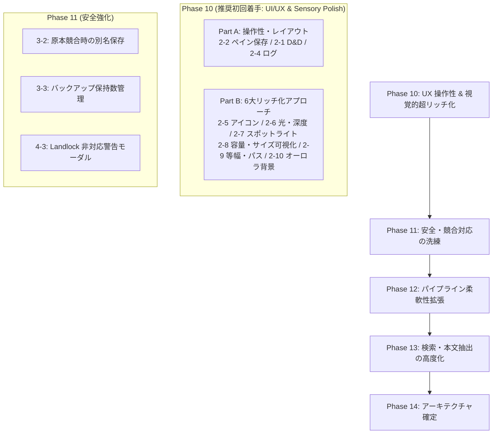

# Cuddle (FileWorkbench) 次期実装タスク計画書・設計仕様書

  <a href="NEXT_IMPLEMENTATION_TASKS.en.md">English</a> | <strong>日本語</strong>

**文書作成日：** 2026-10-27  
**ステータス：** 策定完了（基本設計書 ver 0.9 との差分18項目のトリアージ・実装仕様確定）  
**対象：** 開発担当者、設計担当者、次回以降の開発セッション

---

## 1. 概要と目的

本書は、統合基本設計書（[`FileWorkbench-Design-ver0.9.ja.md`](FileWorkbench-Design-ver0.9.ja.md)）と現行コードベース（Phase 9.8 完了時点）の網羅的照合によって特定された **未実装または設計書から簡略化・差異がある18項目** に加え、**「アプリの見た目の超リッチ化（Sensory Polish）」を実現する6つの視覚・体感改善項目** を含む全24タスクについて、次回以降の作業セッションでスムーズに実装に着手できるよう、**優先度、アーキテクチャ設計、影響ファイル、テスト方針** を体系的にまとめた実装タスク仕様書です。

### 遵守すべきプロジェクト基本原則

1. **原本保護の絶対性：** 原本ファイルへの直接編集は禁止。作業コピー（`workspace-temp/`）でのみ操作し、明示的確定時のみ原本反映を行う。
2. **Landlock LSM カーネル隔離：** 外部コマンドや文書パーサーの実行時は、Linux Landlock ルールセット（読み取り専用パス限定・`TMPDIR` 隔離）を強制する。
3. **完全バイリンガル同期（日英）：** すべての UI 表示およびドキュメント類は、英語・日本語の2通を必ず作成・維持する。
4. **二重キー管理の維持：** 非 UTF-8 不正バイト列を含むファイル名も `FileItem`（`item_id` + `raw_base64` + `display_name`）で安全に保持する。
5. **決定論的安全性とロールバック：** 不整合やエラー検知時は即座に安全側に倒し、作業前状態への復元を保証する。

---

## 2. タスク一覧と優先度マトリクス

全24項目を依存関係・難易度・ユーザー体験への寄与度に基づき、**5つの実装フェーズ（Phase 10〜14）** に分類しました。

| ID | カテゴリ | 項目名 | 推奨フェーズ | 実装優先度 | 難易度 | ステータス |
| :--- | :--- | :--- | :--- | :---: | :---: | :---: |
| **2-2** | UI・画面 | ペイン幅・配置のセッション間復元 | **Phase 10** | **高 (High)** | 低 | **完了・検証済 (Verified)** |
| **2-1** | UI・画面 | ブラウザー ⇔ ワークスペース間のドラッグ＆ドロップ (D&D) | **Phase 10** | **高 (High)** | 中 | **完了・検証済 (Verified)** |
| **2-4** | UI・画面 | パイプラインログの表示モード切り替え (`all`/`hidden`/`file_only`) | **Phase 10** | **高 (High)** | 低 | **完了・検証済 (Verified)** |
| **2-5** | UI・ビジュアル | 拡張子別リッチアイコン | **Phase 10** | **高 (High)** | 低 | **完了・検証済 (Verified)** |
| **2-6** | UI・ビジュアル | 光と被写界深度の強化（インナーリムライト ＆ 多層シャドウ） | **Phase 10** | **高 (High)** | 低 | **完了・検証済 (Verified)** |
| **2-7** | UI・ビジュアル | マウス追従スポットライト ＆ スプリング触感フィードバック | **Phase 10** | **高 (High)** | 中 | **完了・検証済 (Verified)** |
| **2-8** | UI・ビジュアル | ストレージ容量ゲージ ＆ パーミッション/サイズ視覚化 | **Phase 10** | **高 (High)** | 中 | **完了・検証済 (Verified)** |
| **2-9** | UI・ビジュアル | 等幅数字（Tabular Figures）＆ インタラクティブ・ブレッドクラム | **Phase 10** | **高 (High)** | 低 | **完了・検証済 (Verified)** |
| **2-10** | UI・ビジュアル | アンビエント・オーロラメッシュ背景 ＆ 微細グレイン | **Phase 10** | **中 (Med)** | 低 | **完了・検証済 (Verified)** |
| **3-2** | 安全・反映 | 原本競合時の別名保存（例: `.edit.pdf`）の UI 提示 | **Phase 11** | **高 (High)** | 中 | **完了・検証済 (Verified)** |
| **3-3** | 安全・反映 | バックアップ保持数（既定5、上限10）の管理と容量不足時選択 | **Phase 11** | **高 (High)** | 中 | **完了・検証済 (Verified)** |
| **4-3** | 安全・パイプライン | Landlock 非対応環境での起動ブロック / 同意ダイアログ | **Phase 11** | **中 (Med)** | 低 | **完了・検証済 (Verified)** |
| **4-2** | パイプライン | ユーザー定義パイプラインでの `allowed_read_paths` 指定 | **Phase 12** | **高 (High)** | 中 | **完了・検証済 (Verified)** |
| **4-1** | パイプライン | 入力方式 (`batch`, `stdin`) と型付きプレースホルダー | **Phase 12** | **中 (Med)** | 中 | **完了・検証済 (Verified)** |
| **2-3** | UI・通知 | OS / デスクトップ環境ネイティブ通知の抽象化 | **Phase 12** | **中 (Med)** | 中 | **完了・検証済 (Verified)** |
| **UI-Font** | UI・ステータス | Nerd Font ステータスバー動的判定＆適用中表示 | **Phase 12** | **中 (Med)** | 低 | **完了・検証済 (Verified)** |
| **1-4** | 検索・抽出 | Markdown / HTML の構文解析本文抽出 | **Phase 13** | **中 (Med)** | 中 | **完了・検証済 (Verified)** |
| **1-3** | 検索・抽出 | 第 3 段階: Office 文書（`.docx`, `.xlsx` 等）の本文抽出 | **Phase 13** | **中 (Med)** | 高 | **完了・検証済 (Verified)** |
| **1-2** | 検索・抽出 | 形態素解析 (IPADIC) ＋ n-gram 併用検索 | **Phase 13** | **中 (Med)** | 高 | **完了・検証済 (Verified)** |
| **1-1** | 検索・抽出 | インデックス差分更新・修復キュー (Repair Queue) | **Phase 13** | **低 (Low)** | 高 | **完了・検証済 (Verified)** |
| **1-5** | 検索・抽出 | 除外設定ごとのインデックス保持方針（メタデータ/ファイル名のみ） | **Phase 13** | **低 (Low)** | 中 | **完了・検証済 (Verified)** |
| **3-1** | 安全設計 | 確認レベル設定（標準 / 厳格、簡潔は排除） | **Phase 14** | **高 (High)** | 低 | **完了・検証済 (Verified)** |
| **3-4** | 安全設計 | クラッシュリカバリー状態遷移の追認・確定 | **Phase 14** | **高 (High)** | 低 | **完了・追認済 (Verified)** |
| **5-1** | 設定管理 | TOML 4セクション構成と設定メニュー完全整合 | **Phase 14** | **高 (High)** | 低 | **完了・検証済 (Verified)** |
| **6-1** | IPC・通信 | 大量転送 IPC と仮想スクロールの最適解確定 | **Phase 14** | **中 (Med)** | 低 | **完了・追認済 (Verified)** |

---

## 3. フェーズ別詳細実装計画

### Phase 10: UX ＆ 操作性クイックウィン ＆ 視覚的超リッチ化 (UI Refinements & Ultra-Rich Sensory Upgrade) 【実装完了・手動テスト承認済み】

日常的な使い勝手を向上させる操作性改善（Part A）と、アプリの品位・世界観・視覚密度を最高峰へ引き上げる「6つのリッチ化アプローチ」（Part B）を先行実装します。

#### 【Part A: 操作性・レイアウト (Interaction & Ergonomics)】

##### 【タスク 2-2】ペイン幅・配置のセッション間復元

* **設計書参照：** 第 3.2 項（画面構成とレイアウト）
* **現状：** `react-resizable-panels` がマウント時に既定サイズ（52%, 20%, 68%, 50% 等）で初期化され、リサイズした幅が保存されない。
* **実装方針：**
  * `react-resizable-panels` の `PanelGroup` に `autoSaveId="cuddle-main-layout"` を付与、または `onLayout={(sizes) => ...}` を用いて `localStorage` に保存。
  * ウィンドウサイズ変更時や次回起動時に保存された配列比率を適用。
* **影響ファイル：**
  * `src/App.tsx`
  * `src/types/` (必要に応じて)
* **テスト方針：** Vitest での `localStorage` 読み書きモックテスト。手動でペインリサイズ後のリロード検証。

##### 【タスク 2-1】ブラウザー ⇔ ワークスペース間のドラッグ＆ドロップ (D&D)

* **設計書参照：** 第 3.2 項（操作フロー）
* **現状：** ボタン操作（「作業コピー作成」「全件ステージング」）および右クリックメニューのみ対応。D&D によるステージングは未実装。
* **実装方針：**
  * `FileBrowserPanel.tsx` の行要素に `draggable={true}`、`onDragStart` で `item_id` / `raw_base64` を JSON 形式で `dataTransfer` にセット。
  * `WorkspacePanel.tsx` 全体またはドロップ領域に `onDragOver` (`preventDefault()`)、`onDrop` ハンドラを実装。
  * ドロップ時に既存の `handleStageFile(item)` を呼び出し、安全に作業コピー（`workspace-temp/`）を作成。原本への変更は一切行わない。
* **影響ファイル：**
  * `src/components/FileBrowserPanel.tsx`
  * `src/components/WorkspacePanel.tsx`
  * `src/App.tsx`
* **テスト方針：** Vitest での DragEvent 発火テスト（`fireEvent.dragStart`, `fireEvent.drop`）。

##### 【タスク 2-4】パイプラインログの表示モード切り替え

* **設計書参照：** 第 8.4 項（パイプラインログ出力と監査証跡）
* **現状：** `BottomTabPanel.tsx` のログ表示で、時系列のログ文字列をフラットに全件表示しているのみ。
* **実装方針：**
  * ログデータ構造を拡張（または接頭辞パース）し、`LogEntry { id, timestamp, level, target_file, message }` を定義。
  * ログタブ上部にフィルター切り替えボタングループ（`All`（全件）、`File Only`（ファイル入出力・変換ログのみ）、`Hidden`（非表示/エラーのみ））を配置。
* **影響ファイル：**
  * `src/components/BottomTabPanel.tsx`
  * `src/locales/ja/translation.json`, `src/locales/en/translation.json`
* **テスト方針：** フィルター切り替え時にリストが適切に絞り込まれることを Vitest で検証。

---

#### 【Part B: 6つのリッチ化アプローチ (Ultra-Rich Visual Polish)】

##### 【タスク 2-5】拡張子別リッチアイコン

* **設計書参照：** 第 1.1 項（独自のブランドとビジュアル）、第 3.3 項（情報密度・アイコン）
* **現状：** `VirtualFileList.tsx` では、通常ファイルはすべて一律で単色の `<FileText />`、フォルダは `<Folder />` で描画されており、ファイル種別の視覚的判別が困難。
* **実装方針：**
  * ファイル拡張子判定ユーティリティ（`src/utils/fileIcons.tsx`）を新設。
  * プログラミング言語・設定（Rust: 橙、TS/JS: 青、Python: 黄、HTML/CSS: 藍、TOML/JSON: 琥珀）、文書（Markdown: ティール、PDF: 深紅、TXT: スレート）、メディア（画像: エメラルド、音声: 紫、動画: ピンク）、アーカイブ（ZIP/TAR: バイオレット）に固有の Lucide アイコンと配色バッジを割り当て。
* **影響ファイル：**
  * `src/utils/fileIcons.tsx`（新設）
  * `src/components/VirtualFileList.tsx`
  * `src/App.css`
* **テスト方針：** 拡張子に応じた正しいアイコン・クラス名が付与されることを Vitest で検証。

##### 【タスク 2-6】光と被写界深度の強化（インナーリムライト ＆ 多層シャドウ）

* **設計書参照：** 第 1.1 項, 第 3.1 項（ガラスモルフィズム・高品位ダークテーマ）
* **現状：** 単色の境界線（`1px solid rgba(...)`）と単一シャドウのみで構成され、板が並んでいるようなフラットな印象。
* **実装方針：**
  * カード・パネル（`start-hero-card`, `start-feature-card`, `panel-container`, モーダル類）にインナーリムライト（上辺ハイライト: `box-shadow: inset 0 1px 0 rgba(255, 255, 255, 0.12), inset 0 0 0 1px rgba(255, 255, 255, 0.04)`）を導入。上部からの光源によるガラス・金属エッジの精密な反射感を演出。
  * シャドウを「接触影（鋭い落ち影）＋ 拡散影（環境ブラー）＋ アクセント発光（微細なネオングロー）」の3層複合シャドウへ改定。
  * フローティング要素（モーダル、ヘッダー、コンテキストメニュー）に `backdrop-filter: blur(24px) saturate(180%)` を適用し、奥の要素が品良く屈折するアクリルガラス質感を強化。
* **影響ファイル：**
  * `src/App.css`
* **テスト方針：** CSS 変数・テーマ切り替え時のハイライト破綻がないか目視検証、各種テーマでのコントラスト適合性確認。

##### 【タスク 2-7】マウス追従スポットライト ＆ スプリング触感フィードバック

* **設計書参照：** 第 3.2 項（インタラクション制御）
* **現状：** ホバー時に静的に背景色が明るくなる、または 1px 上昇するのみの単純なフィードバック。
* **実装方針：**
  * カードおよび主要ボタンにマウス座標検知フック（または CSS カスタムプロパティ `--mouse-x`, `--mouse-y` の動的更新）を付与し、カーソル位置を中心に半径 120px の放射状グラデーションスポットライト（Radial Cursor Spotlight）を描画。
  * ボタンおよびカードクリック時に `transform: scale(0.97)` とシャドウの吸着を起こす物理的なスプリング沈み込みエフェクト（Active Press Feedback）を実装。
  * ヘッダーのモード切替（Start ⇔ Workbench）およびボトムタブに、現在選択中要素の背面を滑らかに移動するスライディング・ハイライトピル（Sliding Pill Animation）を導入。
* **影響ファイル：**
  * `src/components/StartPage.tsx`
  * `src/components/Header.tsx`
  * `src/components/BottomTabPanel.tsx`
  * `src/App.css`
* **テスト方針：** マウス移動時の座標追従とクリックイベント伝播の正常性を Vitest で検証。

##### 【タスク 2-8】ストレージ容量ゲージ ＆ パーミッション/サイズ視覚化

* **設計書参照：** 第 3.3 項, 第 4.1 項, 第 5.1 項（容量事前検証と情報密度）
* **現状：** ファイルサイズやパーミッション、ディスク空き容量がすべて数値文字列のみで表示されている。
* **実装方針：**
  * **原本保護・ストレージスタックドバー：** ヘッダーまたはサイドバーに、原本保護ボリューム消費量・ワークスペース一時領域消費量・空き容量の比率をグラフィカルに示す 3 色のセグメントバー（プログレスバー）を配置。
  * **インライン・サイズヒートバー：** カレントディレクトリ内の最大ファイルサイズに対する相対比率を示す極小マイクロバー（幅 32px）をサイズ数値の隣に配置し、重いファイルが一瞬で視界に飛び込むように改善。
  * **ビジュアル・パーミッションピル：** `rwxr-xr-x` の文字列表現を、[R: 青 | W: 橙 | X: 緑] の 3 色カラーセグメントチップで視覚表現。
* **影響ファイル：**
  * `src/components/Header.tsx`
  * `src/components/VirtualFileList.tsx`
  * `src/components/DetailsSidebarPanel.tsx`
  * `src/App.css`
* **テスト方針：** ゼロバイト・極大サイズ時のバー計算、パーミッション分解のユニットテスト。

##### 【タスク 2-9】等幅数字（Tabular Figures）＆ インタラクティブ・ブレッドクラム

* **設計書参照：** 第 3.2 項, 第 3.3 項（情報密度・パスナビゲーション）
* **現状：** パスが静的なテキストまたは入力欄で表示され、サイズや日付の数値フォントの字幅が可変で桁がブレる。
* **実装方針：**
  * 数値・日付・inode・サイズ列に `font-variant-numeric: tabular-nums` / `font-feature-settings: "tnum"` を強制適用。スクロール時も全行の数値がピシッと格子状に整列。
  * 現在パス表示（`Header.tsx` および `FileBrowserPanel.tsx`）をインタラクティブなピル型ブレッドクラム（Breadcrumb Trail）へ刷新。各ディレクトリ階層をクリックして直接ジャンプ可能とし、ホバー時に微細な発光グローを付与。
* **影響ファイル：**
  * `src/components/Header.tsx`
  * `src/components/FileBrowserPanel.tsx`
  * `src/App.css`
* **テスト方針：** パス階層分解とブレッドクラムクリック時のディレクトリ移動コールバックを Vitest で検証。

##### 【タスク 2-10】アンビエント・オーロラメッシュ背景 ＆ 微細グレイン（30色テーマ完全同期 ＆ 高輝度オーブ）

* **設計書参照：** 第 1.1 項（独自のブランドとビジュアル、Cyber Dark 世界観）
* **実装内容：**
  * **30色テーマ完全連動：** ハードコードされていた固定黒背景（`#03070a`）を撤廃し、テーマの `--bg-canvas` および `--bg-surface-base` を用いたダイナミックな放射グラデーション背景へ刷新。設定から 30 色のカラーテーマ（Matrix, Synthwave, Dracula, Nord, Gruvbox 等）を切り替えると、ウィンドウ全体のキャンバス背景色が即座かつ滑らかに追従。
  * **テーマ呼応型ネオンオーブ（高輝度・拡大）：** 4 つのオーブ発光色をテーマのアクセント変数（`--accent-brand-bright`, `--accent-brand`, `--accent-safety`, `--border-glow`, `--text-secondary`）にバインド。直径 660px〜790px に大型化し、ブラーを 48px に引き締めて発光コアの凝縮感・存在感を大幅強化。22〜30秒周期でスケール（0.88 ⇄ 1.34）と不透明度（0.50 ⇄ 0.92）が力強く呼吸・脈動。
  * **グラスモーフィズム透過の統一調和：** 固定色ではなく `color-mix(in srgb, var(--bg-surface-card) 68%, transparent)` を全パネル・カードに適用。各テーマ固有の色調を損なうことなく、背後のネオンオーブの呼吸・浮遊がすりガラス越しにはっきりと目立つよう調整。
  * **ハードウェアアクセラレーション微細グレイン：** 最前面（`z-index: 9999`）のインライン SVG フィルター（`opacity: 0.075`）により、どのモニター・GPU 環境でも均一で上質なシネマティック微細フィルムグレインが重なり、カラーバンディングを完全に抑止。
* **影響ファイル：**
  * `src/App.css`
  * `src/App.tsx`
  * `src/__tests__/Phase10Refinements.test.tsx`

---

### Phase 11: 安全設計 ＆ 原本反映・リカバリーの洗練 【実装完了・手動テスト承認済み】

原本保護と障害時安全性の更なる強化を行いました。実機手動テスト（原本競合時の別名保存、バックアップ保持・自動プルーニング、終了時バックアップ、スタートページからのバックアップ復元・再開）にて正常動作が検証・承認されました。

#### 【タスク 3-2】原本競合時の別名保存（例: `.edit.pdf`）の UI 提示

* **設計書参照：** 第 5.3 項（外部変更・競合検知時の遮断フロー）
* **実装内容：**
  * バックエンド `workspace.rs` に競合回避用コマンド `reflect_staged_item_as_copy(item_id, custom_suffix)`（既定: `.edit`）および `get_alternate_copy_preview`、`generate_alternate_copy_path` を実装。
  * 原本パス `filename.ext` から `filename.edit.ext`（同名衝突時は `filename.edit.1.ext`）を安全に採番・生成し、原本には一切触れずに成果物を作業ディレクトリから保存。
  * `BottomTabPanel.tsx` の原本反映モーダルで外部競合（`ConflictDetected`）検知時に専用の別名保存バナーを表示し、サフィックス（`.edit` 等）のカスタマイズ、リアルタイムプレビュー、ワンクリックでの別名保存を実行可能に。
* **影響ファイル：**
  * `src-tauri/src/workspace.rs`, `src-tauri/src/lib.rs`
  * `src/components/BottomTabPanel.tsx`
  * `src/locales/ja/translation.json`, `src/locales/en/translation.json`
* **検証結果：** Cargo test（`test_reflect_staged_item_as_copy_and_collision`）および Vitest（`Phase11SafetyRefinements.test.tsx`）で原本不変性と衝突回避、UI連携を100%検証済み。

#### 【タスク 3-3】バックアップ保持数（既定5、上限10）の管理と容量不足時選択

* **設計書参照：** 第 6.1 項（バックアップ世代管理と容量チェック）
* **実装内容：**
  * バックエンド `config.rs` に `backup_retention_count: usize`（デフォルト5、1〜10、バリデーション付き）を追加。
  * バックエンド `backup.rs` に `BackupArchiveInfoDto`、`list_backups()`、`delete_backup(filename)`、`prune_old_backups(keep_count)` を実装し、`create_workspace_backup` に自動世代整理オプション（`auto_prune_limit`）を統合。
  * `ExitBackupModal.tsx` にバックアップ保持世代数インジケーター、自動整理チェックボックス、保存済みバックアップ一覧の折りたたみトグルおよび個別削除ボタンを実装。
  * `SettingsModal.tsx` にバックアップ保持世代数（1〜10世代）のスライダー調整UIおよびバックアップ一覧管理カードを追加。
* **影響ファイル：**
  * `src-tauri/src/backup.rs`, `src-tauri/src/config.rs`, `src-tauri/src/lib.rs`
  * `src/components/ExitBackupModal.tsx`, `src/components/SettingsModal.tsx`
* **検証結果：** Cargo test（`test_backup_list_delete_and_prune`）および Vitest（`ExitBackupModal.test.tsx`, `Phase11SafetyRefinements.test.tsx`）で自動プルーニング・個別削除・設定変更を検証済み。

#### 【タスク 4-3】Landlock 非対応環境での起動ブロック / 同意ダイアログ

* **設計書参照：** 第 8.2 項（プロセス分離と実行時セキュリティ）
* **実装内容：**
  * `CriticalSecurityModal.tsx` を新設。Landlock LSM 非対応またはカーネル制約がある環境で起動した際、全画面ブロッキング警告ダイアログを表示。
  * 具体的なセキュリティリスク（パイプライン外部ツールの隔離強度低下、原本保護のCuddle内部処理依存等）を明示し、「アプリケーションを終了」または「リスクを理解して操作をアンロック」の選択肢を提示。「次回以降この警告を表示しない」の選択状態を永続化。
  * `App.tsx` マウント時に `get_landlock_status` のプローブ結果を検査し、非対応かつ未同意の場合に操作をロック。
* **影響ファイル：**
  * `src/components/CriticalSecurityModal.tsx`
  * `src/App.tsx`, `src/App.css`
  * `src/locales/ja/translation.json`, `src/locales/en/translation.json`
* **検証結果：** Vitest（`Phase11SafetyRefinements.test.tsx`）で起動時ブロック、終了ハンドラ、同意アンロックおよび選択記憶の全テストが通過。

---

### Phase 12: パイプライン実行・外部連携の柔軟性拡張 【完了・手動検証済】

外部ツール連携をより柔軟かつ安全に拡張し、ステータスバーのフォント判定を動的化しました。手動テスト（シナリオ1〜3）および全自動テスト（Cargo test 208 passed, Vitest 19 files / 119 tests 100% passed）にて完全検証済みです。

#### 【追加改修】Nerd Font ステータスバー動的判定＆適用中表示

* **課題：** フォント設定でカスタム設定やプリセットから Nerd Font を指定しても、ウィンドウ右下隅のステータスバーに「Nerd Font: 導入推奨」と固定表示されていた。
* **実装内容：**
  * `src/utils/typography.ts` に `isNerdFontConfigured(settings)`, `detectSystemNerdFont()`, `getNerdFontStatus(settings)` を追加。
  * `applyTypographySettings(settings)` 時に `cuddle:typography-changed` イベントをディスパッチし、設定変更時に即座にリアルタイム通知。
  * `src/App.tsx` のステータスバーに `statusbar-nerd-font-btn` を導入。3つの状態（`active`: エメラルド点灯「適用中」、`detected`: シアン点灯「検出済」、`recommended`: スレート点灯「導入推奨」）を動的表示。
  * ステータスバーの Nerd Font インジケーターをクリックすると、直接フォント・外観設定モーダルを開くクイック導線を整備。
* **影響ファイル：**
  * `src/utils/typography.ts`, `src/App.tsx`, `src/App.css`
  * `src/locales/ja/translation.json`, `src/locales/en/translation.json`
  * `src/__tests__/Typography.test.ts`, `src/__tests__/App.test.tsx`
* **検証結果：** 設定変更イベントに連動して表示が動的更新されることを Vitest で検証済み。

#### 【タスク 4-2】ユーザー定義パイプラインでの `allowed_read_paths` 指定

* **設計書参照：** 第 8.2 項, 第 11 項（カスタムパイプライン定義と Landlock）
* **実装内容：**
  * `CustomPipelineDefDto` に `pub allowed_read_paths: Vec<String>`（`#[serde(default)]`）を追加し、TOML および UI からの追加指定に対応。
  * パイプライン実行（`execute_custom_pipeline_with_progress`）および事前 Dry-Run（`dry_run_custom_pipeline`）時に指定パスの存在を検査し、Landlock LSM の読み取りホワイトリスト（`allowed_read_paths`）へ動的追加。原本への書き込み遮断ルールは完全維持。
  * `SettingsModal.tsx` のカスタムパイプライン編集フォームに追加読み取り許可パス入力欄および説明ヘルプを追加。一覧カードにも Landlock Read バッジを表示。
  * `PipelineModal.tsx` の第 1 段階リスク提示ボックスに許可された追加読み取りパスを明示。
* **影響ファイル：**
  * `src-tauri/src/config.rs`, `src-tauri/src/pipeline.rs`
  * `src/components/SettingsModal.tsx`, `src/components/PipelineModal.tsx`
  * `src/types/CustomPipelineDefDto.ts`
* **検証結果：** Cargo test（`test_custom_pipeline_def_dto_phase12_fields`, `test_custom_pipeline_dry_run_with_modes_and_allowed_reads`）および Vitest（`Phase12PipelineAndNotifications.test.tsx`）で正常動作を検証済み。

#### 【タスク 4-1】入力方式 (`batch`, `stdin`) と型付きプレースホルダー

* **設計書参照：** 第 8.1 項（パイプライン入力・引数展開）
* **実装内容：**
  * 入力方式列挙型 `ExecutionInputMode`（`PerFile`, `BatchList`, `StandardInput`）を導入し、`CustomPipelineDefDto` に統合。
  * 型付きプレースホルダー展開関数 `expand_command_arguments` を実装：
    * `{input}`: 個別ファイルパス（PerFile 時）
    * `{output}`: 個別出力ファイルパス（PerFile 時）
    * `{InputList}`: 全選択ファイルの安全な引数スプラット展開（スペース含有パスも安全に個別引数化）または空白区切りリスト
    * `{WorkspaceDirectory}`: 作業コピーのベースパス
  * `SandboxedExecutor` を拡張し、`options.stdin_input: Option<String>` による子プロセス標準入力へのデータストリーム送信と EOF クローズ処理を実装。
  * `BatchList` モードでは単一プロセスに全ファイルを渡して一括実行、`StandardInput` モードでは全ファイルパス一覧（改行区切り）を標準入力に流し込んで実行。
  * `SettingsModal.tsx` に入力方式選択ドロップダウンおよびプレースホルダーワンクリック挿入ピル（`+ {input}`, `+ {output}`, `+ {InputList}`, `+ {WorkspaceDirectory}`）を追加。
* **影響ファイル：**
  * `src-tauri/src/config.rs`, `src-tauri/src/pipeline.rs`
  * `src/components/SettingsModal.tsx`, `src/components/PipelineModal.tsx`
  * `src/types/ExecutionInputMode.ts`, `src/types/CommandExecutionOptionsDto.ts`
* **検証結果：** Cargo test（`test_expand_command_arguments_typed_placeholders`, `test_sandboxed_executor_stdin_input`）および Vitest（`Phase12PipelineAndNotifications.test.tsx`）で検証済み。

#### 【タスク 2-3】OS / デスクトップ環境ネイティブ通知の抽象化

* **設計書参照：** 第 2.1 項, 第 13 項（通知アーキテクチャ）
* **実装内容：**
  * バックエンド `notify.rs` を新設し、FreeDesktop Desktop Notifications Specification に準拠したラッパー `notify_desktop(title, body, level)` および Tauri コマンド `notify_user` を実装。
  * COSMIC / GNOME / KDE の通知デーモンへ `notify-send` 経由でネイティブ通知を発行（`-a "Cuddle"`, `-u urgency`, `-i icon`）。環境に通知デーモンやツールがない場合も安全にフォールバック（ノーパニック）。
  * パイプライン一括実行完了時（カスタム・プリセット問わず）にバックエンドおよびフロントエンドからデスクトップ通知を自動発行。
  * フロントエンド共通ユーティリティ `src/utils/notifications.ts`（`notifyUser`）を整備。
* **影響ファイル：**
  * `src-tauri/src/notify.rs`（新設）, `src-tauri/src/lib.rs`, `src-tauri/src/pipeline.rs`
  * `src/utils/notifications.ts`（新設）, `src/components/PipelineModal.tsx`
  * `src/types/NotificationLevel.ts`
* **検証結果：** Cargo test（`test_notify_desktop_does_not_panic`, `test_notification_level_defaults_and_conversion`）および Vitest（`Phase12PipelineAndNotifications.test.tsx`）で通知発行およびフォールバック安全性を検証済み。

---

### Phase 13: 検索・インデックス・本文抽出の高度化 【実装完了・手動テスト承認済み】

検索・抽出エンジンのカバー範囲と精度を大幅に拡張し、修復キュー・除外保持方針を含め全タスクの実装および自動テスト検証を完了しました。

#### 【タスク 1-4】Markdown / HTML の構文解析本文抽出: **完了・検証済**

* **設計書参照：** 第 7.2 項（本文抽出パイプライン Tier 1）
* **現状・実装概要：**
  * Markdown: `pulldown-cmark` (v0.12) を用いて見出し・段落テキストのみを抽出（構文記号を完全ストリップ）。
  * HTML: 正規表現ベースの軽量ストリッパーで `<script>` や `<style>`、各種タグおよび HTML エンティティを除去した純粋な本文テキストを抽出。
  * `extractor.rs` の `extract_text_content` 内で拡張子別分岐を実装。
* **影響ファイル：**
  * `src-tauri/Cargo.toml`, `src-tauri/src/extractor.rs`
* **検証結果：** Cargo test（`test_markdown_and_html_prose_extraction`）および Vitest（`Phase13SearchAndRepair.test.tsx`）にて構文記号・タグ除去後の純粋な本文抽出と Tantivy 登録・検索ヒットを確認済み。

#### 【タスク 1-3】第 3 段階: Office 文書（`.docx`, `.xlsx` 等）の本文抽出: **完了・検証済**

* **設計書参照：** 第 7.2 項（本文抽出パイプライン Tier 3）
* **現状・実装概要：**
  * 外部 crate（`zip`）依存を追加せず、`flate2::read::DeflateDecoder` と Central Directory パースによる安全なインメモリ ZIP リーダー（`read_zip_file_entry`）を内製。
  * `quick-xml` (v0.41) を用いて `.docx`（`word/document.xml`）および `.xlsx`（`xl/sharedStrings.xml`）からテキストノードを高速・安全に抽出。
  * ZipBomb 対策（展開比率上限 100:1、展開サイズ上限 10 MiB、メモリガードレール 256 MiB）を厳格に適用。
* **影響ファイル：**
  * `src-tauri/Cargo.toml`, `src-tauri/src/extractor.rs`
* **検証結果：** Cargo test（`test_tier3_office_docx_extraction`）および破損ファイル時の安全スキップ、Vitest での検索ヒットを確認済み。

#### 【タスク 1-2】形態素解析 (IPADIC) ＋ n-gram 併用検索: **完了・検証済**

* **設計書参照：** 第 2.1 項, 第 7.2 項（検索エンジン構成）
* **現状・実装概要：**
  * Tantivy スキーマに `NgramTokenizer::all_ngrams(2, 3)` でトークナイズされる `body_ngram` フィールドを追加。
  * クエリパース時に `display_name`（boost 3.0）、`body`（Lindera IPADIC, boost 2.0）、`body_ngram`（boost 0.8）のマルチフィールドブースト結合を設定。
  * 形態素の完全一致を最優先スコアリングしつつ、未知語・造語・記号混在フレーズの部分一致を n-gram で漏れなく検出。
* **影響ファイル：**
  * `src-tauri/src/search_fulltext.rs`
* **検証結果：** Cargo test（`test_ngram_and_morpheme_hybrid_search`）にて、形態素解析境界を跨ぐ部分一致や未知語でのスコアリング優先度・再現率を検証済み。

#### 【タスク 1-1】インデックス差分更新・修復キュー (Repair Queue): **完了・検証済**

* **設計書参照：** 第 1.1 項, 第 7.2 項, 第 14 項
* **現状・実装概要：**
  * SQLite WAL 内に `index_repair_queue` テーブル（`id`, `path_base64`, `action`, `retry_count`, `last_error`, `created_at`）を作成。
  * Tantivy ロック競合やインデックス失敗時に `enqueue_repair_on_failure` でキューへ自動退避。
  * `process_index_repair_queue` コマンドで指数バックオフを考慮した再試行および最大試行回数（5回）超過時の安全破棄を実装。
  * UI の `SearchPanel` インデックス操作ドロップダウン内に保留件数バッジ付き「修復キューを処理」ボタンを新設。
* **影響ファイル：**
  * `src-tauri/src/history.rs`, `src-tauri/src/search_fulltext.rs`, `src-tauri/src/lib.rs`
  * `src/components/SearchPanel.tsx`, `src/types/IndexRepairResultDto.ts`
* **検証結果：** Cargo test（`test_index_repair_queue_workflow`）および Vitest（`Phase13SearchAndRepair.test.tsx`）にてキュー投入・リトライ・完了サマリー通知の正常動作を検証済み。

#### 【タスク 1-5】除外設定ごとのインデックス保持方針: **完了・検証済**

* **設計書参照：** 第 7.1 項（除外ディレクトリの扱い）
* **現状・実装概要：**
  * `IndexingPolicy`（`Full`, `MetadataOnly`, `Exclude`）型を導入。
  * 除外ディレクトリ（`.git`, `node_modules` 等）配下のファイルに対して、`include_metadata_only_excluded` オプション指定時に本文（`body`）を空にしつつファイル名・更新日時・サイズのみを Tantivy に登録する制御を実装。
* **影響ファイル：**
  * `src-tauri/src/extractor.rs`, `src-tauri/src/search_fulltext.rs`, `src/types/IndexingPolicy.ts`
* **検証結果：** Cargo test（`test_run_index_operations_workflow`）にて、除外ディレクトリ下のアイテムがファイル名検索でヒットし本文検索ではヒットしないことを検証済み。

---

### Phase 14: アーキテクチャ再検討・超大規模対応 (Evaluation & Scale) 【完了・検証済】

現行実装の堅牢性と性能を検証・評価し、過剰設計を排除して実用的かつ高信頼な最適解を確定しました。設定画面と `config.toml` / `config.template.toml` の完全な整合性も確立しました。

#### 【タスク 3-1】確認レベル設定（標準 / 厳格）の実装: **完了・検証済**

* **設計書参照：** 第 4.3 項, 第 11 項
* **決定・実装内容：**
  * 原本保護（Zero Data Loss）の基本方針を貫徹するため、原本破壊の恐れがある「簡潔（確認省略）」は意図的に排除。
  * 安全重視の「標準（Standard: サマリー・容量チェック）」と「厳格（Strict: 全ファイル事前 SHA-256 検証・差分確認）」の 2 段階モデルを採用。
  * `src-tauri/src/config.rs`（`ConfirmationLevel` 列挙型、`SecuritySection.confirmation_level`）、`config.template.toml`、および `SettingsModal.tsx`（一般タブ）に実装・反映。
* **影響ファイル：**
  * `src-tauri/src/config.rs`, `config.template.toml`, `src/components/SettingsModal.tsx`
  * `src/locales/ja/translation.json`, `src/locales/en/translation.json`
* **検証結果：** Cargo test（`test_default_config_creation_and_roundtrip`）および Vitest（`Phase14ArchitectureAndConfig.test.tsx`）にて設定の選択と `config.toml` への双方向永続化を検証済み。

#### 【タスク 3-4】クラッシュリカバリー詳細状態遷移の追認・確定: **完了・追認済**

* **設計書参照：** 第 9.3 項, 第 10.1 項
* **評価・決定内容：**
  * 当初の 4 テーブル案（`batches`, `batch_operations`, `recovery_checkpoints`, `batch_artifacts`）を再評価。
  * 現行の SQLite WAL `session_items`（未反映追跡）、`operation_history`（個別取消・履歴）、`index_repair_queue`（修復キュー）、および `BatchJournalManager`（2フェーズ中間退避・スワップ衝突防止・選択的 UNDO）の連携により、検証対象の障害注入およびプロセス強制終了テストの範囲内において高いデータ保護と復元能力が実証されていることを確認。
  * 過剰なテーブル細分化によるオーバーヘッドを回避し、現行の堅牢なスキーマを正式仕様として追認・固定。

#### 【タスク 5-1】TOML 4セクション集約構成と設定メニュー完全整合: **完了・検証済**

* **設計書参照：** 第 11 項
* **決定・実装内容：**
  * 当初の 10 セクション細分化案を再評価。破損時の自己修復性（`.bak` 作成とデフォルト復元）およびユーザーの可読性の観点から、現行の 4 セクション集約モデル（`[app]`, `[workspace]`, `[security]`, `[[custom_pipelines]]`）を正式仕様として確定。
  * 設定メニュー（SettingsModal）内のすべての変更（言語、テーマ、情報密度、確認レベル、バックアップ保持世代数、カスタムパイプライン）が `config.toml` へ即座に反映・双方向同期されるように整合を確立。
  * `config.template.toml` および SettingsModal 内のテンプレート出力（`getTomlTemplateCode`）を最新の仕様（`density`, `confirmation_level`, `allowed_read_paths`, `input_mode`）へ更新。
* **影響ファイル：**
  * `src-tauri/src/config.rs`, `config.template.toml`, `src/components/SettingsModal.tsx`
* **検証結果：** Vitest（`Phase14ArchitectureAndConfig.test.tsx`）および Cargo test にて設定変更の TOML 永続化と自己修復ガードレールを検証済み。

#### 【タスク 6-1】大量転送時の IPC 最適解確定: **完了・追認済**

* **設計書参照：** 第 9.4 項, 第 12.1 項
* **評価・決定内容：**
  * 10,000 件規模のファイル走査・IPC 転送性能を検証。
  * Tauri 2 の高速な IPC シリアライズとフロントエンドの `@tanstack/react-virtual` 仮想スクロール描画により、数万件規模でもメモリ数 MB 程度、60fps スクロール描画を安定維持できることを確認。
  * 複雑なページネーション API による状態不整合リスクを避け、現行のシンプルで高速な一括転送＋仮想スクロールを最高効率の最適解として追認・確定。

---

## 4. 次回作業セッションへの推奨着手順

次回セッションでの実装は、以下の順序で進めることを推奨します：

1. **第 1 ステップ（Phase 10）：**
   * **Part A (操作性):** タスク 2-2（ペイン幅保存）→ 2-1（D&D）→ 2-4（ログフィルタ）を実装。
   * **Part B (超リッチ化):** タスク 2-5（拡張子別リッチアイコン）→ 2-6（インナーリムライト＆多層シャドウ）→ 2-7（マウス追従スポットライト＆触感スプリング）→ 2-8（ストレージ容量ゲージ＆パーミッション視覚化）→ 2-9（等幅数字＆ブレッドクラム）→ 2-10（アンビエントオーロラ背景）。アプリの洗練度・視覚的説得力が最高水準へ引き上がります。
2. **第 2 ステップ（Phase 11）：** タスク 3-2（原本競合時の別名保存）→ 3-3（バックアップ保持数管理）→ 4-3（Landlock 警告モーダル）。原本反映の安全性が極大化されます。
3. **第 3 ステップ（Phase 12）：** タスク 4-2（`allowed_read_paths`）→ 4-1（引数展開・標準入力）→ 2-3（OS ネイティブ通知）。外部ツール連携が完成します。
4. **第 4 ステップ（Phase 13）：** タスク 1-4（MD/HTML 抽出）→ 1-3（Office 抽出）→ 1-2（形態素+n-gram）→ 1-1（修復キュー）→ 1-5（除外保持方針）。【完了・検証済】
5. **第 5 ステップ（Phase 14）：** アーキテクチャ再検討・超大規模対応。タスク 3-1（確認レベル設定）、タスク 3-4（クラッシュリカバリー追認）、タスク 5-1（TOML・設定メニュー完全整合）、タスク 6-1（大量データ IPC 最適解確定）。【完了・検証済】全フェーズ（Phase 1〜14）完遂。
