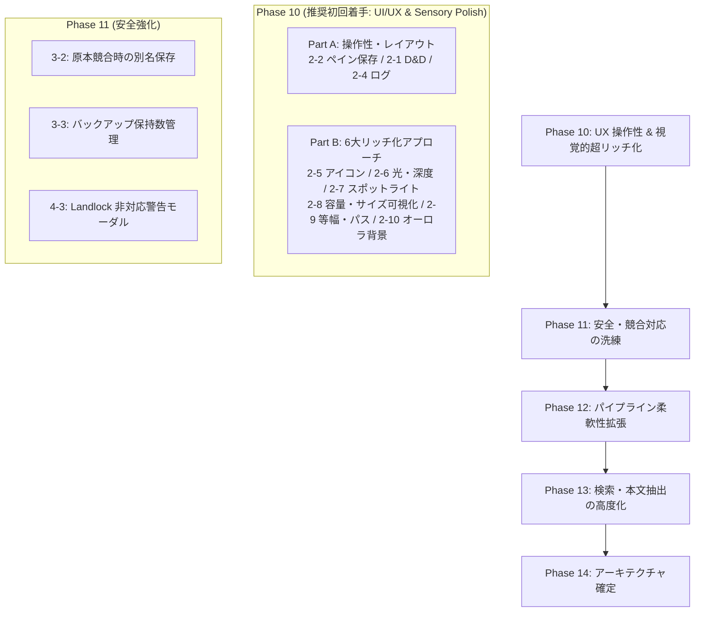

# Cuddle (FileWorkbench) 次期実装タスク計画書・設計仕様書

  <a href="NEXT_IMPLEMENTATION_TASKS.en.md">English</a> | <strong>日本語</strong>

**文書作成日：** 2026-10-27  
**ステータス：** 策定完了（基本設計書 ver 0.9 との差分18項目のトリアージ・実装仕様確定）  
**対象：** 開発担当者、設計担当者、次回以降の開発セッション

---

## 1. 概要と目的

本書は、統合基本設計書（[`FileWorkbench-Design-ver0.9.ja.md`](FileWorkbench-Design-ver0.9.ja.md)）と現行コードベース（Phase 9.8 完了時点）の網羅的照合によって特定された **未実装または設計書から簡略化・差異がある18項目** に加え、**「アプリの見た目の超リッチ化（Sensory Polish）」を実現する6つの視覚・体感改善項目** を含む全24タスクについて、次回以降の作業セッションでスムーズに実装に着手できるよう、**優先度、アーキテクチャ設計、影響ファイル、テスト方針** を体系的にまとめた実装タスク仕様書です。

### 遵守すべきプロジェクト基本原則

1. **原本保護の絶対性：** 原本ファイルへの直接編集は禁止。作業コピー（`workspace-temp/`）でのみ操作し、明示的確定時のみ原本反映を行う。
2. **Landlock LSM カーネル隔離：** 外部コマンドや文書パーサーの実行時は、Linux Landlock ルールセット（読み取り専用パス限定・`TMPDIR` 隔離）を強制する。
3. **完全バイリンガル同期（日英）：** すべての UI 表示およびドキュメント類は、英語・日本語の2通を必ず作成・維持する。
4. **二重キー管理の維持：** 非 UTF-8 不正バイト列を含むファイル名も `FileItem`（`item_id` + `raw_base64` + `display_name`）で安全に保持する。
5. **決定論的安全性とロールバック：** 不整合やエラー検知時は即座に安全側に倒し、作業前状態への復元を保証する。

---

## 2. タスク一覧と優先度マトリクス

全24項目を依存関係・難易度・ユーザー体験への寄与度に基づき、**5つの実装フェーズ（Phase 10〜14）** に分類しました。

| ID | カテゴリ | 項目名 | 推奨フェーズ | 実装優先度 | 難易度 | ステータス |
| :--- | :--- | :--- | :--- | :---: | :---: | :---: |
| **2-2** | UI・画面 | ペイン幅・配置のセッション間復元 | **Phase 10** | **高 (High)** | 低 | **完了・検証済 (Verified)** |
| **2-1** | UI・画面 | ブラウザー ⇔ ワークスペース間のドラッグ＆ドロップ (D&D) | **Phase 10** | **高 (High)** | 中 | **完了・検証済 (Verified)** |
| **2-4** | UI・画面 | パイプラインログの表示モード切り替え (`all`/`hidden`/`file_only`) | **Phase 10** | **高 (High)** | 低 | **完了・検証済 (Verified)** |
| **2-5** | UI・ビジュアル | 拡張子別リッチアイコン | **Phase 10** | **高 (High)** | 低 | **完了・検証済 (Verified)** |
| **2-6** | UI・ビジュアル | 光と被写界深度の強化（インナーリムライト ＆ 多層シャドウ） | **Phase 10** | **高 (High)** | 低 | **完了・検証済 (Verified)** |
| **2-7** | UI・ビジュアル | マウス追従スポットライト ＆ スプリング触感フィードバック | **Phase 10** | **高 (High)** | 中 | **完了・検証済 (Verified)** |
| **2-8** | UI・ビジュアル | ストレージ容量ゲージ ＆ パーミッション/サイズ視覚化 | **Phase 10** | **高 (High)** | 中 | **完了・検証済 (Verified)** |
| **2-9** | UI・ビジュアル | 等幅数字（Tabular Figures）＆ インタラクティブ・ブレッドクラム | **Phase 10** | **高 (High)** | 低 | **完了・検証済 (Verified)** |
| **2-10** | UI・ビジュアル | アンビエント・オーロラメッシュ背景 ＆ 微細グレイン | **Phase 10** | **中 (Med)** | 低 | **完了・検証済 (Verified)** |
| **3-2** | 安全・反映 | 原本競合時の別名保存（例: `.edit.pdf`）の UI 提示 | **Phase 11** | **高 (High)** | 中 | **完了・検証済 (Verified)** |
| **3-3** | 安全・反映 | バックアップ保持数（既定5、上限10）の管理と容量不足時選択 | **Phase 11** | **高 (High)** | 中 | **完了・検証済 (Verified)** |
| **4-3** | 安全・パイプライン | Landlock 非対応環境での起動ブロック / 同意ダイアログ | **Phase 11** | **中 (Med)** | 低 | **完了・検証済 (Verified)** |
| **4-2** | パイプライン | ユーザー定義パイプラインでの `allowed_read_paths` 指定 | **Phase 12** | **高 (High)** | 中 |
| **4-1** | パイプライン | 入力方式 (`batch`, `stdin`) と型付きプレースホルダー | **Phase 12** | **中 (Med)** | 中 |
| **2-3** | UI・通知 | OS / デスクトップ環境ネイティブ通知の抽象化 | **Phase 12** | **中 (Med)** | 中 |
| **1-4** | 検索・抽出 | Markdown / HTML の構文解析本文抽出 | **Phase 13** | **中 (Med)** | 中 |
| **1-3** | 検索・抽出 | 第 3 段階: Office 文書（`.docx`, `.xlsx` 等）の本文抽出 | **Phase 13** | **中 (Med)** | 高 |
| **1-2** | 検索・抽出 | 形態素解析 (IPADIC) ＋ n-gram 併用検索 | **Phase 13** | **中 (Med)** | 高 |
| **1-1** | 検索・抽出 | インデックス差分更新・修復キュー (Repair Queue) | **Phase 13** | **低 (Low)** | 高 |
| **1-5** | 検索・抽出 | 除外設定ごとのインデックス保持方針（メタデータ/ファイル名のみ） | **Phase 13** | **低 (Low)** | 中 |
| **3-1** | 安全設計 | 確認レベルの 4 段階設定（簡潔 / 標準 / 詳細 / 厳格） | **Phase 14** | **要検討** | 中 |
| **3-4** | 安全設計 | 4 テーブルによるクラッシュリカバリー詳細状態遷移 | **Phase 14** | **現状維持推奨** | 高 |
| **5-1** | 設定管理 | TOML 10 セクション構成への細分化 | **Phase 14** | **現状維持推奨** | 中 |
| **6-1** | IPC・通信 | 大量転送時の IPC チャンク分割ストリーミング / ページネーション | **Phase 14** | **要計測** | 高 |

---

## 3. フェーズ別詳細実装計画

### Phase 10: UX ＆ 操作性クイックウィン ＆ 視覚的超リッチ化 (UI Refinements & Ultra-Rich Sensory Upgrade) 【実装完了・手動テスト承認済み】

日常的な使い勝手を向上させる操作性改善（Part A）と、アプリの品位・世界観・視覚密度を最高峰へ引き上げる「6つのリッチ化アプローチ」（Part B）を先行実装します。

#### 【Part A: 操作性・レイアウト (Interaction & Ergonomics)】

##### 【タスク 2-2】ペイン幅・配置のセッション間復元

* **設計書参照：** 第 3.2 項（画面構成とレイアウト）
* **現状：** `react-resizable-panels` がマウント時に既定サイズ（52%, 20%, 68%, 50% 等）で初期化され、リサイズした幅が保存されない。
* **実装方針：**
  * `react-resizable-panels` の `PanelGroup` に `autoSaveId="cuddle-main-layout"` を付与、または `onLayout={(sizes) => ...}` を用いて `localStorage` に保存。
  * ウィンドウサイズ変更時や次回起動時に保存された配列比率を適用。
* **影響ファイル：**
  * `src/App.tsx`
  * `src/types/` (必要に応じて)
* **テスト方針：** Vitest での `localStorage` 読み書きモックテスト。手動でペインリサイズ後のリロード検証。

##### 【タスク 2-1】ブラウザー ⇔ ワークスペース間のドラッグ＆ドロップ (D&D)

* **設計書参照：** 第 3.2 項（操作フロー）
* **現状：** ボタン操作（「作業コピー作成」「全件ステージング」）および右クリックメニューのみ対応。D&D によるステージングは未実装。
* **実装方針：**
  * `FileBrowserPanel.tsx` の行要素に `draggable={true}`、`onDragStart` で `item_id` / `raw_base64` を JSON 形式で `dataTransfer` にセット。
  * `WorkspacePanel.tsx` 全体またはドロップ領域に `onDragOver` (`preventDefault()`)、`onDrop` ハンドラを実装。
  * ドロップ時に既存の `handleStageFile(item)` を呼び出し、安全に作業コピー（`workspace-temp/`）を作成。原本への変更は一切行わない。
* **影響ファイル：**
  * `src/components/FileBrowserPanel.tsx`
  * `src/components/WorkspacePanel.tsx`
  * `src/App.tsx`
* **テスト方針：** Vitest での DragEvent 発火テスト（`fireEvent.dragStart`, `fireEvent.drop`）。

##### 【タスク 2-4】パイプラインログの表示モード切り替え

* **設計書参照：** 第 8.4 項（パイプラインログ出力と監査証跡）
* **現状：** `BottomTabPanel.tsx` のログ表示で、時系列のログ文字列をフラットに全件表示しているのみ。
* **実装方針：**
  * ログデータ構造を拡張（または接頭辞パース）し、`LogEntry { id, timestamp, level, target_file, message }` を定義。
  * ログタブ上部にフィルター切り替えボタングループ（`All`（全件）、`File Only`（ファイル入出力・変換ログのみ）、`Hidden`（非表示/エラーのみ））を配置。
* **影響ファイル：**
  * `src/components/BottomTabPanel.tsx`
  * `src/locales/ja/translation.json`, `src/locales/en/translation.json`
* **テスト方針：** フィルター切り替え時にリストが適切に絞り込まれることを Vitest で検証。

---

#### 【Part B: 6つのリッチ化アプローチ (Ultra-Rich Visual Polish)】

##### 【タスク 2-5】拡張子別リッチアイコン

* **設計書参照：** 第 1.1 項（独自のブランドとビジュアル）、第 3.3 項（情報密度・アイコン）
* **現状：** `VirtualFileList.tsx` では、通常ファイルはすべて一律で単色の `<FileText />`、フォルダは `<Folder />` で描画されており、ファイル種別の視覚的判別が困難。
* **実装方針：**
  * ファイル拡張子判定ユーティリティ（`src/utils/fileIcons.tsx`）を新設。
  * プログラミング言語・設定（Rust: 橙、TS/JS: 青、Python: 黄、HTML/CSS: 藍、TOML/JSON: 琥珀）、文書（Markdown: ティール、PDF: 深紅、TXT: スレート）、メディア（画像: エメラルド、音声: 紫、動画: ピンク）、アーカイブ（ZIP/TAR: バイオレット）に固有の Lucide アイコンと配色バッジを割り当て。
* **影響ファイル：**
  * `src/utils/fileIcons.tsx`（新設）
  * `src/components/VirtualFileList.tsx`
  * `src/App.css`
* **テスト方針：** 拡張子に応じた正しいアイコン・クラス名が付与されることを Vitest で検証。

##### 【タスク 2-6】光と被写界深度の強化（インナーリムライト ＆ 多層シャドウ）

* **設計書参照：** 第 1.1 項, 第 3.1 項（ガラスモルフィズム・高品位ダークテーマ）
* **現状：** 単色の境界線（`1px solid rgba(...)`）と単一シャドウのみで構成され、板が並んでいるようなフラットな印象。
* **実装方針：**
  * カード・パネル（`start-hero-card`, `start-feature-card`, `panel-container`, モーダル類）にインナーリムライト（上辺ハイライト: `box-shadow: inset 0 1px 0 rgba(255, 255, 255, 0.12), inset 0 0 0 1px rgba(255, 255, 255, 0.04)`）を導入。上部からの光源によるガラス・金属エッジの精密な反射感を演出。
  * シャドウを「接触影（鋭い落ち影）＋ 拡散影（環境ブラー）＋ アクセント発光（微細なネオングロー）」の3層複合シャドウへ改定。
  * フローティング要素（モーダル、ヘッダー、コンテキストメニュー）に `backdrop-filter: blur(24px) saturate(180%)` を適用し、奥の要素が品良く屈折するアクリルガラス質感を強化。
* **影響ファイル：**
  * `src/App.css`
* **テスト方針：** CSS 変数・テーマ切り替え時のハイライト破綻がないか目視検証、各種テーマでのコントラスト適合性確認。

##### 【タスク 2-7】マウス追従スポットライト ＆ スプリング触感フィードバック

* **設計書参照：** 第 3.2 項（インタラクション制御）
* **現状：** ホバー時に静的に背景色が明るくなる、または 1px 上昇するのみの単純なフィードバック。
* **実装方針：**
  * カードおよび主要ボタンにマウス座標検知フック（または CSS カスタムプロパティ `--mouse-x`, `--mouse-y` の動的更新）を付与し、カーソル位置を中心に半径 120px の放射状グラデーションスポットライト（Radial Cursor Spotlight）を描画。
  * ボタンおよびカードクリック時に `transform: scale(0.97)` とシャドウの吸着を起こす物理的なスプリング沈み込みエフェクト（Active Press Feedback）を実装。
  * ヘッダーのモード切替（Start ⇔ Workbench）およびボトムタブに、現在選択中要素の背面を滑らかに移動するスライディング・ハイライトピル（Sliding Pill Animation）を導入。
* **影響ファイル：**
  * `src/components/StartPage.tsx`
  * `src/components/Header.tsx`
  * `src/components/BottomTabPanel.tsx`
  * `src/App.css`
* **テスト方針：** マウス移動時の座標追従とクリックイベント伝播の正常性を Vitest で検証。

##### 【タスク 2-8】ストレージ容量ゲージ ＆ パーミッション/サイズ視覚化

* **設計書参照：** 第 3.3 項, 第 4.1 項, 第 5.1 項（容量事前検証と情報密度）
* **現状：** ファイルサイズやパーミッション、ディスク空き容量がすべて数値文字列のみで表示されている。
* **実装方針：**
  * **原本保護・ストレージスタックドバー：** ヘッダーまたはサイドバーに、原本保護ボリューム消費量・ワークスペース一時領域消費量・空き容量の比率をグラフィカルに示す 3 色のセグメントバー（プログレスバー）を配置。
  * **インライン・サイズヒートバー：** カレントディレクトリ内の最大ファイルサイズに対する相対比率を示す極小マイクロバー（幅 32px）をサイズ数値の隣に配置し、重いファイルが一瞬で視界に飛び込むように改善。
  * **ビジュアル・パーミッションピル：** `rwxr-xr-x` の文字列表現を、[R: 青 | W: 橙 | X: 緑] の 3 色カラーセグメントチップで視覚表現。
* **影響ファイル：**
  * `src/components/Header.tsx`
  * `src/components/VirtualFileList.tsx`
  * `src/components/DetailsSidebarPanel.tsx`
  * `src/App.css`
* **テスト方針：** ゼロバイト・極大サイズ時のバー計算、パーミッション分解のユニットテスト。

##### 【タスク 2-9】等幅数字（Tabular Figures）＆ インタラクティブ・ブレッドクラム

* **設計書参照：** 第 3.2 項, 第 3.3 項（情報密度・パスナビゲーション）
* **現状：** パスが静的なテキストまたは入力欄で表示され、サイズや日付の数値フォントの字幅が可変で桁がブレる。
* **実装方針：**
  * 数値・日付・inode・サイズ列に `font-variant-numeric: tabular-nums` / `font-feature-settings: "tnum"` を強制適用。スクロール時も全行の数値がピシッと格子状に整列。
  * 現在パス表示（`Header.tsx` および `FileBrowserPanel.tsx`）をインタラクティブなピル型ブレッドクラム（Breadcrumb Trail）へ刷新。各ディレクトリ階層をクリックして直接ジャンプ可能とし、ホバー時に微細な発光グローを付与。
* **影響ファイル：**
  * `src/components/Header.tsx`
  * `src/components/FileBrowserPanel.tsx`
  * `src/App.css`
* **テスト方針：** パス階層分解とブレッドクラムクリック時のディレクトリ移動コールバックを Vitest で検証。

##### 【タスク 2-10】アンビエント・オーロラメッシュ背景 ＆ 微細グレイン（30色テーマ完全同期 ＆ 高輝度オーブ）

* **設計書参照：** 第 1.1 項（独自のブランドとビジュアル、Cyber Dark 世界観）
* **実装内容：**
  * **30色テーマ完全連動：** ハードコードされていた固定黒背景（`#03070a`）を撤廃し、テーマの `--bg-canvas` および `--bg-surface-base` を用いたダイナミックな放射グラデーション背景へ刷新。設定から 30 色のカラーテーマ（Matrix, Synthwave, Dracula, Nord, Gruvbox 等）を切り替えると、ウィンドウ全体のキャンバス背景色が即座かつ滑らかに追従。
  * **テーマ呼応型ネオンオーブ（高輝度・拡大）：** 4 つのオーブ発光色をテーマのアクセント変数（`--accent-brand-bright`, `--accent-brand`, `--accent-safety`, `--border-glow`, `--text-secondary`）にバインド。直径 660px〜790px に大型化し、ブラーを 48px に引き締めて発光コアの凝縮感・存在感を大幅強化。22〜30秒周期でスケール（0.88 ⇄ 1.34）と不透明度（0.50 ⇄ 0.92）が力強く呼吸・脈動。
  * **グラスモーフィズム透過の統一調和：** 固定色ではなく `color-mix(in srgb, var(--bg-surface-card) 68%, transparent)` を全パネル・カードに適用。各テーマ固有の色調を損なうことなく、背後のネオンオーブの呼吸・浮遊がすりガラス越しにはっきりと目立つよう調整。
  * **ハードウェアアクセラレーション微細グレイン：** 最前面（`z-index: 9999`）のインライン SVG フィルター（`opacity: 0.075`）により、どのモニター・GPU 環境でも均一で上質なシネマティック微細フィルムグレインが重なり、カラーバンディングを完全に抑止。
* **影響ファイル：**
  * `src/App.css`
  * `src/App.tsx`
  * `src/__tests__/Phase10Refinements.test.tsx`

---

### Phase 11: 安全設計 ＆ 原本反映・リカバリーの洗練 【実装完了・手動テスト承認済み】

原本保護と障害時安全性の更なる強化を行いました。実機手動テスト（原本競合時の別名保存、バックアップ保持・自動プルーニング、終了時バックアップ、スタートページからのバックアップ復元・再開）にて正常動作が検証・承認されました。

#### 【タスク 3-2】原本競合時の別名保存（例: `.edit.pdf`）の UI 提示

* **設計書参照：** 第 5.3 項（外部変更・競合検知時の遮断フロー）
* **実装内容：**
  * バックエンド `workspace.rs` に競合回避用コマンド `reflect_staged_item_as_copy(item_id, custom_suffix)`（既定: `.edit`）および `get_alternate_copy_preview`、`generate_alternate_copy_path` を実装。
  * 原本パス `filename.ext` から `filename.edit.ext`（同名衝突時は `filename.edit.1.ext`）を安全に採番・生成し、原本には一切触れずに成果物を作業ディレクトリから保存。
  * `BottomTabPanel.tsx` の原本反映モーダルで外部競合（`ConflictDetected`）検知時に専用の別名保存バナーを表示し、サフィックス（`.edit` 等）のカスタマイズ、リアルタイムプレビュー、ワンクリックでの別名保存を実行可能に。
* **影響ファイル：**
  * `src-tauri/src/workspace.rs`, `src-tauri/src/lib.rs`
  * `src/components/BottomTabPanel.tsx`
  * `src/locales/ja/translation.json`, `src/locales/en/translation.json`
* **検証結果：** Cargo test（`test_reflect_staged_item_as_copy_and_collision`）および Vitest（`Phase11SafetyRefinements.test.tsx`）で原本不変性と衝突回避、UI連携を100%検証済み。

#### 【タスク 3-3】バックアップ保持数（既定5、上限10）の管理と容量不足時選択

* **設計書参照：** 第 6.1 項（バックアップ世代管理と容量チェック）
* **実装内容：**
  * バックエンド `config.rs` に `backup_retention_count: usize`（デフォルト5、1〜10、バリデーション付き）を追加。
  * バックエンド `backup.rs` に `BackupArchiveInfoDto`、`list_backups()`、`delete_backup(filename)`、`prune_old_backups(keep_count)` を実装し、`create_workspace_backup` に自動世代整理オプション（`auto_prune_limit`）を統合。
  * `ExitBackupModal.tsx` にバックアップ保持世代数インジケーター、自動整理チェックボックス、保存済みバックアップ一覧の折りたたみトグルおよび個別削除ボタンを実装。
  * `SettingsModal.tsx` にバックアップ保持世代数（1〜10世代）のスライダー調整UIおよびバックアップ一覧管理カードを追加。
* **影響ファイル：**
  * `src-tauri/src/backup.rs`, `src-tauri/src/config.rs`, `src-tauri/src/lib.rs`
  * `src/components/ExitBackupModal.tsx`, `src/components/SettingsModal.tsx`
* **検証結果：** Cargo test（`test_backup_list_delete_and_prune`）および Vitest（`ExitBackupModal.test.tsx`, `Phase11SafetyRefinements.test.tsx`）で自動プルーニング・個別削除・設定変更を検証済み。

#### 【タスク 4-3】Landlock 非対応環境での起動ブロック / 同意ダイアログ

* **設計書参照：** 第 8.2 項（プロセス分離と実行時セキュリティ）
* **実装内容：**
  * `CriticalSecurityModal.tsx` を新設。Landlock LSM 非対応またはカーネル制約がある環境で起動した際、全画面ブロッキング警告ダイアログを表示。
  * 具体的なセキュリティリスク（パイプライン外部ツールの隔離強度低下、原本保護のCuddle内部処理依存等）を明示し、「アプリケーションを終了」または「リスクを理解して操作をアンロック」の選択肢を提示。「次回以降この警告を表示しない」の選択状態を永続化。
  * `App.tsx` マウント時に `get_landlock_status` のプローブ結果を検査し、非対応かつ未同意の場合に操作をロック。
* **影響ファイル：**
  * `src/components/CriticalSecurityModal.tsx`
  * `src/App.tsx`, `src/App.css`
  * `src/locales/ja/translation.json`, `src/locales/en/translation.json`
* **検証結果：** Vitest（`Phase11SafetyRefinements.test.tsx`）で起動時ブロック、終了ハンドラ、同意アンロックおよび選択記憶の全テストが通過。

---

### Phase 12: パイプライン実行・外部連携の柔軟性拡張

外部ツール連携をより柔軟かつ安全に拡張します。

#### 【タスク 4-2】ユーザー定義パイプラインでの `allowed_read_paths` 指定

* **設計書参照：** 第 8.2 項, 第 11 項（カスタムパイプライン定義と Landlock）
* **現状：** `sandbox.rs` の `LandlockSandbox` は `allow_read(path)` をサポートしているが、`CustomPipelineDefDto` に設定項目がなく、TOML や UI から追加できない。
* **実装方針：**
  * `CustomPipelineDefDto` に `pub allowed_read_paths: Vec<String>` を追加（`#[serde(default)]`）。
  * パイプライン実行時に、これらのパスを検証した上で `LandlockSandbox::allow_read` に追加登録。
  * パイプライン設定モーダル（`PipelineModal.tsx`）に追加読み取り許可パスの入力欄を追加。
* **影響ファイル：**
  * `src-tauri/src/config.rs`, `src-tauri/src/pipeline.rs`
  * `src/components/PipelineModal.tsx`
  * `src/types/CustomPipelineDefDto.ts`
* **テスト方針：** Cargo test で追加読み取りパスが Landlock ルールセットに正しく反映されることをテスト。

#### 【タスク 4-1】入力方式 (`batch`, `stdin`) と型付きプレースホルダー

* **設計書参照：** 第 8.1 項（パイプライン入力・引数展開）
* **現状：** 各ファイル個別（`per_file`）での `{input}` / `{output}` 文字列置換のみ。
* **実装方針：**
  * `ExecutionInputMode` enum (`PerFile`, `BatchList`, `StandardInput`) を導入。
  * プレースホルダーの拡張：
    * `{input}`: 個別ファイルパス
    * `{output}`: 個別出力ファイルパス
    * `{InputList}`: 全選択ファイルの空白区切りリスト
    * `{WorkspaceDirectory}`: 作業コピーのベースパス
  * `batch` モード時は単一プロセスに全引数を渡して一括実行。`stdin` モード時はファイルパス一覧を子プロセスの標準入力に書き込み。
* **影響ファイル：**
  * `src-tauri/src/config.rs`, `src-tauri/src/pipeline.rs`
  * `src/components/PipelineModal.tsx`
* **テスト方針：** 引数展開・標準入力パイプラインの動作をモックコマンドで Cargo test 検証。

#### 【タスク 2-3】OS / デスクトップ環境ネイティブ通知の抽象化

* **設計書参照：** 第 2.1 項, 第 13 項（通知アーキテクチャ）
* **現状：** アプリ内のトースト通知バナーのみ。
* **実装方針：**
  * Tauri 2 公式プラグイン `@tauri-apps/plugin-notification`（または Rust 側 `notify-rust`）を導入。
  * COSMIC / GNOME / KDE の FreeDesktop D-Bus 通知を呼び出すラッパー `notify_user(title, body, level)` を実装。
  * 長時間の一括変換、インデックス全再構築完了時、重大エラー発生時に、ウィンドウがバックグラウンドにあってもデスクトップ通知を発行。
* **影響ファイル：**
  * `src-tauri/Cargo.toml`, `src-tauri/src/lib.rs`
  * `src/App.tsx`, `package.json`
* **テスト方針：** 通知発行のユニットテストおよび DE での受信確認。

---

### Phase 13: 検索・インデックス・本文抽出の高度化

検索・抽出エンジンのカバー範囲と精度を拡張します。

#### 【タスク 1-4】Markdown / HTML の構文解析本文抽出

* **設計書参照：** 第 7.2 項（本文抽出パイプライン Tier 1）
* **現状：** Markdown / HTML ファイルはプレーンテキストとしてそのまま読み込まれている。
* **実装方針：**
  * Markdown: `pulldown-cmark` クレートを用いて見出し・段落テキストのみを抽出（記号除去）。
  * HTML: 軽量パーサーまたは正規表現ストリッパーで `<tag>` や `<style>`, `<script>` を除去した本文テキストを抽出。
  * `extractor.rs` の `extract_text_content` 内で拡張子分岐を追加。
* **影響ファイル：**
  * `src-tauri/Cargo.toml`, `src-tauri/src/extractor.rs`
* **テスト方針：** タグやマークダウン修飾が除去された純粋な本文が抽出され、Tantivy インデックスに登録されることを検証。

#### 【タスク 1-3】第 3 段階: Office 文書（`.docx`, `.xlsx` 等）の本文抽出

* **設計書参照：** 第 7.2 項（本文抽出パイプライン Tier 3）
* **現状：** Tier 1（テキスト/コード）と Tier 2（PDF `pdftotext`）のみ対応。
* **実装方針：**
  * Office OpenXML（`.docx`, `.xlsx`）は ZIP 形式の XML 構造であるため、`zip` クレートと簡易 XML パーサーで `word/document.xml` や `xl/sharedStrings.xml` からテキスト要素を抽出。
  * PDF 同様、巨大ファイルや悪意ある ZIP ボム（42.zip 等）から本体を保護するため、メモリ上限（256 MiB）とサイズ上限（10 MiB）の安全ガードレールを適用。
* **影響ファイル：**
  * `src-tauri/Cargo.toml`, `src-tauri/src/extractor.rs`
* **テスト方針：** サンプル .docx, .xlsx からの本文抽出ユニットテスト。破損ファイル時の安全スキップテスト。

#### 【タスク 1-2】形態素解析 (IPADIC) ＋ n-gram 併用検索

* **設計書参照：** 第 2.1 項, 第 7.2 項（検索エンジン構成）
* **現状：** `lindera-tantivy`（IPADIC, Normal）単独でトークナイズ。
* **実装方針：**
  * Tantivy のスキーマにおいて、本文フィールドを「形態素解析トークナイズ用フィールド（`body_morpheme`）」と「2-gram トークナイズ用フィールド（`body_ngram`）」の2系統で登録、または複合トークナイザーを定義。
  * 検索クエリ実行時、形態素クエリと n-gram クエリを重み付け結合（形態素一致を優先スコアリングしつつ、未知語・記号混在は n-gram でヒットさせる）。
* **影響ファイル：**
  * `src-tauri/src/search_fulltext.rs`
* **テスト方針：** 未知語、カタカナ語、記号混在検索語での再現率・精度のテスト。

#### 【タスク 1-1】インデックス差分更新・修復キュー (Repair Queue)

* **設計書参照：** 第 1.1 項, 第 7.2 項, 第 14 項
* **現状：** インデックス登録失敗時はエラーログを記録するのみ。
* **実装方針：**
  * SQLite WAL 内に `index_repair_queue` テーブル（`id`, `path_base64`, `action`, `retry_count`, `last_error`, `created_at`）を作成。
  * 原本反映やファイル移動時に Tantivy 更新が失敗した場合、即座にキューへ退避。
  * アプリ起動時および定期更新タイマー実行時にキュー内の未処理アイテムを再試行・修復。
* **影響ファイル：**
  * `src-tauri/src/search_fulltext.rs`, `src-tauri/src/db.rs`, `src-tauri/src/periodic_index.rs`
* **テスト方針：** Tantivy ロック競合時のキュー退避と、その後の修復処理を Cargo test で検証。

#### 【タスク 1-5】除外設定ごとのインデックス保持方針

* **設計書参照：** 第 7.1 項（除外ディレクトリの扱い）
* **現状：** 走査時に除外するか、あるいは全抽出するかの二者択一。
* **実装方針：**
  * 除外ディレクトリ（`.git`, `node_modules` 等）配下のファイルは、本文（`body`）を空にし、ファイル名・パス・mtime のメタデータのみインデックスに保持。
* **影響ファイル：**
  * `src-tauri/src/extractor.rs`, `src-tauri/src/search_fulltext.rs`
* **テスト方針：** 除外対象ファイルがファイル名検索ではヒットし、本文検索ではヒットしないことを確認。

---

### Phase 14: アーキテクチャ再検討・超大規模対応 (Evaluation & Scale)

現行実装の堅牢性を評価し、過剰設計を避けて実用的な最適解を確定します。

#### 【タスク 3-1】確認レベルの 4 段階設定（簡潔 / 標準 / 詳細 / 厳格）

* **設計書参照：** 第 4.3 項, 第 11 項
* **検討方針：**
  * 現行は「標準・厳格（安全重視）」に統一されており、誤操作による原本破壊を防止できている。
  * 設定画面に「確認レベル（標準 / 厳格）」の選択肢を追加し、「簡潔」は意図的に排除（原本保護の思想に反するため）するのが安全設計上推奨。

#### 【タスク 3-4】4 テーブルによるクラッシュリカバリー詳細状態遷移

* **設計書参照：** 第 9.3 項, 第 10.1 項
* **検討方針：**
  * 現行は SQLite WAL の `session_items` と `operation_history`、および `BatchJournalManager` によるセッション復元＆選択的 UNDO で完全動作している。
  * 4テーブル（`batches`, `batch_operations`, `recovery_checkpoints`, `batch_artifacts`）への過剰な細分化は行わず、現行の堅牢なスキーマを維持することを推奨（設計書側の改定を検討）。

#### 【タスク 5-1】TOML 10 セクション構成への細分化

* **設計書参照：** 第 11 項
* **検討方針：**
  * 現行の `[app]`, `[workspace]`, `[security]`, `[[custom_pipelines]]` の4セクションは理解しやすく設定ファイルの破損リスクも低い。
  * 必要に応じて `[search]` や `[backup]` セクションを追加する段階的アプローチを推奨。

#### 【タスク 6-1】大量転送時の IPC チャンク分割ストリーミング / ページネーション

* **設計書参照：** 第 9.4 項, 第 12.1 項
* **検討方針：**
  * 現行の `@tanstack/react-virtual` 仮想スクロールにより 10,000 件規模でも 60fps 描画を達成。
  * IPC 境界での転送時間（JSON デシリアライズ負荷）を実測し、ボトルネックが確認された場合のみページネーション API（`get_items_page(offset, limit)`）を新設。

---

## 4. 次回作業セッションへの推奨着手順

次回セッションでの実装は、以下の順序で進めることを推奨します：

1. **第 1 ステップ（Phase 10）：**
   * **Part A (操作性):** タスク 2-2（ペイン幅保存）→ 2-1（D&D）→ 2-4（ログフィルタ）を実装。
   * **Part B (超リッチ化):** タスク 2-5（拡張子別リッチアイコン）→ 2-6（インナーリムライト＆多層シャドウ）→ 2-7（マウス追従スポットライト＆触感スプリング）→ 2-8（ストレージ容量ゲージ＆パーミッション視覚化）→ 2-9（等幅数字＆ブレッドクラム）→ 2-10（アンビエントオーロラ背景）。アプリの洗練度・視覚的説得力が最高水準へ引き上がります。
2. **第 2 ステップ（Phase 11）：** タスク 3-2（原本競合時の別名保存）→ 3-3（バックアップ保持数管理）→ 4-3（Landlock 警告モーダル）。原本反映の安全性が極大化されます。
3. **第 3 ステップ（Phase 12）：** タスク 4-2（`allowed_read_paths`）→ 4-1（引数展開・標準入力）→ 2-3（OS ネイティブ通知）。外部ツール連携が完成します。
4. **第 4 ステップ（Phase 13）：** タスク 1-4（MD/HTML 抽出）→ 1-3（Office 抽出）→ 1-2（形態素+n-gram）→ 1-1（修復キュー）。
