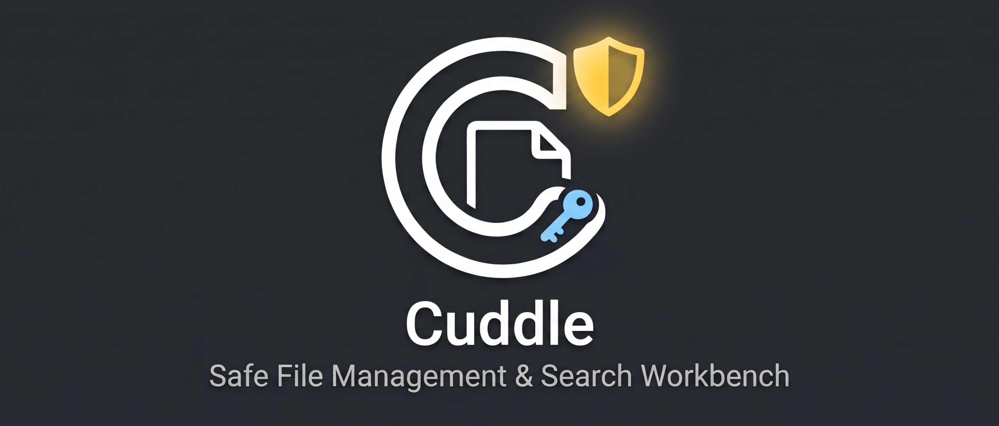

<p align="center">
  
</p>

<p align="center">
  
</p>

# Cuddle

<p align="center">
  <strong>File Workbench</strong><br />
  <em>A safe Linux file workbench that hugs your originals tight.</em>
</p>

<p align="center">
  <strong>English</strong> | <a href="README.ja.md">日本語</a> | <a href="IP_COMPLIANCE.md">IP Compliance</a>
</p>

---

## 1. Overview

**Cuddle** is a high-reliability file management, full-text search, and batch operation workbench designed natively for Linux desktops (CachyOS, COSMIC DE, Wayland, HiDPI).

Rooted in the philosophy of **"hugging your originals tight,"** Cuddle provides an isolated, non-destructive working environment where your original files remain physically untouched until you explicitly commit the final results.

---

## 2. Core Architectural Principles

1. **Absolute Original Protection:**  
   Original files are strictly opened in read-only mode. All operations, conversions, and batch edits occur inside an isolated working copy (`workspace-temp/`).
2. **Commit / In-Place Separation:**  
   Pipeline executions and renames never alter originals in-place. Changes are applied only through an independent, explicit user commit action.
3. **Kernel-Level Landlock LSM Sandbox:**  
   External tools (e.g., ImageMagick, ffmpeg, cwebp) are strictly restricted before `exec` using Linux Landlock LSM, physically denying write access to original folders or `$HOME`.
4. **Deterministic Rollback (RollbackAll):**  
   If even a single item fails during a batch operation, the entire transaction is deterministically aborted and restored to its exact initial state.
5. **Dual-Key Non-UTF-8 Path Safety:**  
   Rust maintains raw byte paths (`[u8]`). IPC boundaries expose a Base64 key (`raw_base64`) paired with safe UTF-8 strings (`display_name`) identified by immutable UUIDs, ensuring zero crashes on malformed filenames.
6. **Full Dynamic Bilingualism (en / ja):**  
   Every menu, dialog, and message is fully localized in English and Japanese, dynamically switchable at runtime without restarting.

---

## 3. UI/UX Concept & Design System

### "Simple yet Ultra-Rich" (Dark Velvet & Radiant Protection)
- **Minimalist Clarity:** Distraction-free, high-density layouts designed for developers and power users.
- **Glassmorphism & Depth:** Soft frosted-glass panels (`backdrop-filter: blur(16px)`), ultra-thin hairline borders (`1px rgba(255, 255, 255, 0.08)`), and pulsing safety indicators.
- **Visual Harmony:** Cohesive with Linux desktop design systems, featuring subtle glow accents on security and conflict states.

### Typography & Font Strategy (Pre-required Nerd Font)
- **Zero Font Bundling:** Cuddle **does not bundle** large font binaries like Nerd Font, keeping the distribution lean, secure, and respectful of licensing.
- **Pre-required System Font Stack:**
  - **UI (Sans-Serif):** `Inter`, system UI font fallback, and high-legibility CJK (`Noto Sans CJK JP`).
  - **Code & Paths (Monospace):** `JetBrains Mono`, `Fira Code`, `Noto Sans Mono CJK JP`.
  - **Glyphs & Icons (Nerd Font Fallback):** `Symbols Nerd Font`, `JetBrainsMono Nerd Font`.
- **Bulletproof Fallback:** If Nerd Font is not installed on the system, Cuddle gracefully falls back to system monospace and renders all primary icons via built-in `lucide-react` SVG vectors with zero broken glyphs or tofu characters.

---

## 4. Prerequisites

- **OS:** Linux kernel 5.13+ (Landlock LSM ABI V1–V5 supported; tested on CachyOS / COSMIC DE)
- **Node.js:** v20+ / pnpm v9+
- **Rust:** 1.80+ (Edition 2021)
- **Optional Recommended Fonts:**  
  `ttf-nerd-fonts-symbols` or any Nerd Font package (e.g. `sudo pacman -S ttf-nerd-fonts-symbols` on Arch/CachyOS) for rich CLI/status glyphs.

---

## 5. Development & Testing

```bash
# Install frontend dependencies
pnpm install

# Run frontend tests (Vitest)
pnpm test

# Run Rust unit & Landlock security tests
cd src-tauri && cargo test && cd ..

# Launch development application
pnpm tauri dev
```

---

## 6. License & Compliance

- **Code:** Distributed under the MIT License. See [LICENSE](LICENSE) for details.
- **Icon & Branding:** See [IP_COMPLIANCE.md](IP_COMPLIANCE.md) for full AI-assisted design provenance and intellectual property diligence records.
